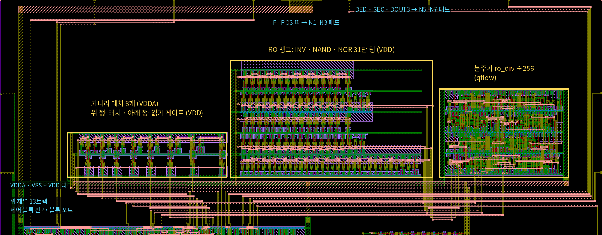

# ECC 8T SRAM 칩 안내

마이칩(ETRI 0.5 µm CMOS) 제출용 최종 GDS와 그 내용을 정리한 문서다. 칩의 주제, 각 부분이 하는 일, 검증 결과, Codespaces에서 결과물을 여는 방법을 담았다. 세부 사양은 [spec.md](spec.md), 단계별 검증 과정과 판단은 [verification.md](verification.md), 회로 구조와 한 주기의 동작은 [operation.md](operation.md)에 있다.

## 1. 최종 결과물

| 파일 | 내용 |
|---|---|
| `designs/etri050/chip/final/ecc_sram_Top.gds.gz` | 제출용 칩 GDS(gzip). 최상위 셀 `ecc_sram_Top` |
| `designs/etri050/chip/final/ecc_sram_Top.gds.sha256` | 압축을 푼 GDS와 압축 파일의 sha256 |
| `designs/etri050/chip/final/check_report.txt` | 이 GDS를 만든 전체 재검사 기록(`check_all.sh --save`) |

- 공정: ETRI NSPL 0.5 µm CMOS 2P3M 5 V, 28핀 패드 틀(MPW_PAD_28pin)
- GDS 범위 1705 × 1705 µm, 설계 면적(패드 셀 안쪽) 1016 × 1016 µm, 트랜지스터 게이트 5,626개(패드 셀 포함)
- 셀 계층

```
ecc_sram_Top
├── ecc_sram_core          코어 (chip/assemble.py가 조립)
│   ├── ecc_fi_ctrl_F      제어 블록: 합성 364셀(배치 후 버퍼 포함 485셀), qflow 배치·배선
│   ├── sram_macro         8T 셀 어레이 15 × 8 + 컬럼 회로
│   ├── decap_vddw         VDDW 디커플링 57 pF
│   ├── decap_vdda         VDDA 디커플링 28.5 pF
│   ├── canary_flat        신뢰성 모니터: 카나리 래치 8개 (VDDA)
│   ├── robank_flat        신뢰성 모니터: RO 뱅크 INV · NAND · NOR
│   └── ro_div_F           신뢰성 모니터: 분주기 ÷256, qflow 배치·배선
└── ecc_sram_Pad           패드 링: ETRI GPIO 패드 28개와 코너·필러 셀
```

## 2. 칩 주제

SRAM은 전원 전압이 낮거나 셀이 약하면 저장한 값을 잃거나, 잘못 읽거나, 쓰지 못한다. ECC는 이런 비트 오류를 고치거나 검출한다. 이 칩은 작은 SRAM에 Hamming(8,4) SEC-DED를 붙이고 오류를 일부러 만들어서, ECC가 실제로 무엇을 고치고 무엇을 놓치는지 측정하는 칩이다.

오류는 두 가지 방법으로 만든다.

1. **논리 결함 주입**: 핀(FI_MODE, FI_POS)으로 고른 비트를 쓸 때(1·2·3비트) 또는 읽을 때(1·2비트) 뒤집는다. 결과가 정해져 있으므로 ECC 회로 자체를 시험한다
2. **물리 결함**: 셀 전원 VDDA와 비트라인 드라이버 전원 VDDW를 따로 핀으로 받는다. 이 둘을 낮추면 보존 실패(값을 잃음), 읽기 실패, 쓰기 실패가 실제 셀에서 생긴다. 어느 비트가 먼저 틀릴지는 셀마다 다르다(공정 편차)

원시 보기(읽기 모드 11)는 저장된 8비트를 정정 없이 그대로 읽는다. 원시 보기로 실패 비트 지도를 만들고 같은 워드의 정정 출력과 SEC/DED가 그 지도와 맞는지 비교하는 것이 측정의 중심이다.

코어 위쪽에는 신뢰성 모니터를 넣었다(4.8절, 설계안과 검토는 [monitor.md](monitor.md)). 카나리 래치 8개는 셀과 같은 VDDA에 있으면서 셀보다 높은 전압에서 차례로 값을 잃어 보존 실패가 다가오는 것을 알리고, RO 뱅크 세 링의 주파수는 그 다이가 어느 공정 코너 쪽인지 알려 준다. 측정값을 그 코너의 모의값과 비교할 수 있다.

- 16워드 × 8비트(데이터 4 + 검사 4) = 128비트
- 주소 0–14: 맞춤 설계한 8T 셀 행. 주소 15: 제어 블록 안의 표준셀 플립플롭 8개(기준 워드). 어레이가 동작하지 않아도 ECC와 논리 결함 주입은 주소 15로 확인할 수 있다

## 3. 칩 전체와 핀


번호는 패키지 핀 번호(반시계). 파랑 입력(PIC), 주황 출력(POB8), 빨강 VDD(PVDD), 회색 VSS(PVSS), 초록 VDDA·VDDW(PANA).

| 핀 | 신호 | 패드 셀 | 기능 | 핀 | 신호 | 패드 셀 | 기능 |
|---|---|---|---|---|---|---|---|
| 1 | DIN3 | PIC | 쓰기 데이터 3 | 15 | VSS | PVSS | 접지·기판 |
| 2 | ADDR3 | PIC | 주소 3 | 16 | VDDW | PANA (PADR) | 비트라인 드라이버 전원 |
| 3 | ADDR2 | PIC | 주소 2 | 17 | VDDA | PANA (PADR) | 셀 어레이 전원 |
| 4 | ADDR1 | PIC | 주소 1 | 18 | VSS | PVSS | 접지·기판 |
| 5 | ADDR0 | PIC | 주소 0 | 19 | DOUT0 | POB8 | 데이터 출력 0 |
| 6 | WE | PIC | 쓰기(1) / 읽기(0) | 20 | DOUT1 | POB8 | 데이터 출력 1 |
| 7 | CLK | PIC | 0 프리차지, 1 읽기·쓰기 | 21 | DOUT2 | POB8 | 데이터 출력 2 |
| 8 | FI_MODE1 | PIC | 결함 모드 1 | 22 | DOUT3 | POB8 | 데이터 출력 3 |
| 9 | FI_MODE0 | PIC | 결함 모드 0 | 23 | SEC | POB8 | 1비트 오류(정정함) |
| 10 | DIN2 | PIC | 쓰기 데이터 2 | 24 | DED | POB8 | 2비트 오류 검출 |
| 11 | DIN1 | PIC | 쓰기 데이터 1 | 25 | VDD | PVDD | 링·코어 전원 5 V |
| 12 | DIN0 | PIC | 쓰기 데이터 0 | 26 | FI_POS2 | PIC | 결함 위치 2 |
| 13 | VSS | PVSS | 접지·기판 | 27 | FI_POS1 | PIC | 결함 위치 1 |
| 14 | VDD | PVDD | 링·코어 전원 5 V | 28 | FI_POS0 | PIC | 결함 위치 0, 보기 반쪽 선택 |

패드 위치와 셀은 `designs/etri050/chip/pins.csv`가 정한다.

## 4. 각 부분이 하는 일

### 4.1 패드 링

- 킷의 28핀 템플릿 자리에 셀 종류만 바꿨고, 셀 내용은 ETRI GPIO 라이브러리 원본 그대로다(제출 GDS 검사에서 원본과 같음을 확인)
- PIC 입력 버퍼 15개, POB8 출력 버퍼 6개, PVDD 2개, PVSS 3개, PANA 2개
- PANA는 코어 쪽 저항 포트 PADR(약 0.7 kΩ 직렬)로 VDDA와 VDDW를 받는다. 이 핀에는 누설과 쓰기 전하만 흘러 저항 강하는 mV 수준이다
- 측정 중 입력 핀을 띄워 두지 않는다

### 4.2 코어 배치


- 왼쪽 제어 블록, 가운데 SRAM 매크로, 오른쪽 디커플링 둘, 위쪽 신뢰성 모니터(카나리, RO 뱅크, 분주기)
- 배선은 층을 나눠 같은 층끼리 엇갈리지 않게 했다. 워드라인 30개(WWL 15, RWL 15)는 제어 블록 오른쪽 핀에서 매크로 왼쪽 접점으로 간다
- 아래 채널: S 패드 입력, 매크로로 가는 PRE_N·WD[7:0], 매크로에서 오는 SENSE[7:0]. 위 채널(13트랙): 출력 6개와 모니터 신호 17개. N 패드 입력 FI_POS 셋은 카나리 왼쪽으로 곧게 올라가 맨 위 띠로 패드에 간다
- 전원 띠(metal3): VSS, VDD(N4 패드 → 제어 블록, S7 패드 → 매크로 VDD 버스), VDDW·VDDA(오른쪽 PANA 패드 → 디커플링 → 매크로). 모니터 아래 띠: VDD(metal1, 제어 블록 vdd 스파인에서), VSS(제어 블록 gnd 스파인과 매크로 VSS 버스에서), VDDA(매크로 VDDA 버스에서)

### 4.3 제어 블록 ecc_fi_ctrl


`designs/etri050/ctrl/ecc_fi_ctrl/ecc_fi_ctrl.v`를 공개 킷의 표준셀로 합성하고 qflow로 배치·배선했다. 합성 364셀(배치 후 버퍼 포함 485셀), 495.9 × 520.05 µm, 핀 84개. 배치·배선 결과는 `ctrl/macro`에 고정해 두고 칩 조립에 그대로 쓴다.

| 기능 | 하는 일 |
|---|---|
| 부호기 | DIN[3:0] → 코드워드 C[7:0] = {D3, D2, D1, P2, D0, P1, P0, PALL} |
| 쓰기 결함 마스크 | 쓰기 때 FI_MODE 01 / 10 / 11 → 비트 k / k, k^1 / k, k^1, k^2를 뒤집어 저장(k = FI_POS) |
| 행 해독 | ADDR 0–14 → CLK = 1인 동안 WWL(쓰기) 또는 RWL(읽기) 하나를 5 V로 |
| 쓰기 데이터 | WD[7:0] = 저장할 코드워드 → 매크로의 비트라인 드라이버 |
| 프리차지 | PRE_N: CLK = 0일 때 읽기 비트라인 RBL을 VDD로 올린다 |
| 기준 워드 | 주소 15는 플립플롭 8개. CLK 상승에서 쓴다 |
| 읽기 결함 마스크 | 읽기 때 FI_MODE 01 / 10 → 센스 출력 뒤 비트 k / k, k^1을 뒤집는다(일시 오류) |
| 신드롬·판정 | 신드롬 = 틀린 비트의 위치. 전체 패리티 불일치 → SEC = 1(1비트로 보고 정정), 신드롬 ≠ 0이고 패리티 일치 → DED = 1 |
| 원시 보기 | 읽기 FI_MODE 11, FI_POS[2:1] = 00: FI_POS0 = 1이면 DOUT = {R7, R6, R5, R3}(데이터 비트), 0이면 {R4, R2, R1, R0}(검사 비트) |
| 모니터 보기 | 읽기 FI_MODE 11, FI_POS[2:1] = 01 카나리 보기(CRD_N = 0), 10 카나리 세트(CSET = CLK), 11 RO 보기(DIN[1:0] → RO_EN, DOUT0 = RO_DIV). 4.8절 |

1비트 오류는 정정되고 SEC, 2비트는 DED로 나온다. 3비트 저장 오류는 SEC-DED의 한계대로 오정정(SEC = 1, 틀린 데이터)으로 나온다.

### 4.4 SRAM 매크로


- 8T 셀 15행 × 8열(셀 18.0 × 27.3 µm) 아래에 열마다 컬럼 회로를 붙였다. 181.5 × 498.9 µm
- 셀은 VDDA, 읽기 회로는 VDD, 쓰기 드라이버는 VDDW. 세 전원을 매크로 오른쪽 버스로 따로 받는다
- 레이아웃은 `gen/sram8t.py`, `gen/colper.py`가 사각형 좌표를 계산해 Magic으로 그린다. 같은 코드가 LVS용 넷리스트도 쓴다

#### 8T 셀


- 6T 저장부(PU, PD, PG)와 읽기 포트 2개(RD1 게이트 QB, RD2 게이트 RWL)
- W/L(µm): PU 1.8/0.6, PD 3.0/0.6, PG 1.8/0.6, RD1·RD2 3.0/0.6
- 쓰기: WWL = 1이면 PG가 BL·BLB를 Q·QB에 잇는다
- 읽기: RWL = 1이면 Q = 0인 셀이 RBL을 끌어내린다(RBL은 Q를 따른다). 읽기 전류가 저장 노드를 거치지 않아 읽는다고 값이 뒤집히지 않는다

#### 컬럼 회로


- 읽기(VDD): 프리차지 P(게이트 PRE_N)가 CLK = 0 동안 RBL을 올리고, keeper P(게이트 SB)가 RBL의 높은 값을 약하게 붙잡는다. 센스 인버터 → SB → 출력 인버터 → SENSE(Q와 같은 극성)
- 쓰기(VDDW): BLB = not WD, BL = not BLB. 드라이버는 항상 켜져 있고 쓰기는 선택된 행의 WWL만으로 정해진다. VDDW가 쓸 때 비트라인의 높은 값이다
- 인버터는 손가락 2개씩이고 소스를 이웃 열과 나눠 써서 열 간격 18 µm 안에 들어간다

### 4.5 전원과 디커플링

| 전원 | 핀 | 쓰는 곳 | 평소 | 실험 |
|---|---|---|---|---|
| VDD | 14, 25 | 패드, 제어 블록, 읽기 회로 | 5 V | 고정 |
| VDDA | 17 | 셀 어레이 | 5 V | 보존·읽기 실험에서 낮춤 |
| VDDW | 16 | 비트라인 드라이버 | 5 V | 쓰기 실험에서 낮춤 |

- VDDA·VDDW는 PADR 저항을 거쳐 들어오므로, 쓰기 때 비트라인을 충전하는 순간 전하는 칩 안 디커플링(NMOS 게이트 커패시터, VDDW 57 pF, VDDA 28.5 pF)이 댄다
- VDDA·VDDW는 VDD보다 높이지 않는다(PANA의 ESD 다이오드가 VDD 쪽으로 켜진다). VDD를 먼저 켜고 VDDA·VDDW를 나중에 켠다

### 4.6 타이밍

- CLK = 0: 읽기 비트라인 프리차지. ADDR, WE, DIN, FI_*는 CLK = 0일 때만 바꾼다
- CLK = 1: 선택된 행 읽기 또는 쓰기. 읽기 출력은 CLK = 1인 동안 유효하다(CLK = 0 동안은 프리차지 값 1111)
- 기준 워드(주소 15)는 CLK 상승에서 쓴다
- 측정 클록은 수 kHz–1 MHz면 충분하다. 칩 모의는 주기 200 ns로 확인했다

### 4.7 물리 결함 실험 요약

| 실험 | 조건 | 실패 모양 | 모의 기준값 |
|---|---|---|---|
| 보존 | 5 V에서 쓰고 VDDA = VDDW를 V_hold로 10 s 이상, 5 V로 올려 읽기 | 저장값을 잃음 | 보존 전압 TT 0.37 V |
| 읽기 Vmin | VDDA를 낮춘 채 읽기(VDDW = VDDA) | 0이 1로 읽힘 | TT 1.42 V |
| 쓰기 Vmin | VDDA = 5 V, VDDW를 낮추며 쓰고 5 V에서 읽기 | 쓰기가 안 됨 | 1.73–1.94 V(TT 27 °C 1.86 V) |

보존 실험은 두 패턴(값과 반전)을 모두 본다. 자세한 절차는 [spec.md](spec.md)의 측정 계획.

### 4.8 신뢰성 모니터



| 블록 | 크기 (µm) | 하는 일 |
|---|---|---|
| 카나리 래치 `canary_flat` (`gen/canary.py`) | 270.6 × 76.8 | 래치 8개가 VDDA에 있다. 약한 PMOS(L 2.4–30 µm)가 넓은 NMOS의 누설을 이겨야 세트 상태가 남으므로, VDDA를 내리면 C7부터 C0까지 차례로 값을 잃는다(TT 0.575 → 0.428 V, 셀 0.387 V 위). 읽기 게이트(VDD)는 CRD_N = 0일 때만 켜진다 |
| RO 뱅크 `robank_flat` (`gen/robank.py`) | 345.1 × 198.9 | 31단 링 INV·NAND·NOR. 한 번에 하나만 돈다. INV는 전체 속도, NAND/NOR 비는 N/P 기울기 |
| 분주기 `ro_div_F` (`ctrl/ro_div`) | 219.6 × 150.9 | 도는 링의 탭을 256분주해 제어 블록으로(DOUT0). 링이 없으면 리셋 |

| 보기 (읽기, FI_MODE 11) | FI_POS | DOUT |
|---|---|---|
| 카나리 보기 | 010 / 011 | CAN[3:0] / CAN[7:4] (1 = 잃음) |
| 카나리 세트 | 100 / 101 | 같음, CLK = 1 동안 8개 모두 세트 |
| RO 보기 | 11x | {0, 0, 0, RO_DIV}, DIN[1:0] = 00 INV, 01 NAND, 10 NOR, 11 없음 |

- 카나리는 5 V에서 세트하고, VDDA를 낮춰 30 s 이상 둔 뒤 5 V로 되돌려 읽는다. 원시 보기의 셀 실패 지도와 같은 다이에서 함께 본다
- RO는 DOUT0의 주파수 × 256. 후모의 표(verification.md 12절)와 비교해 코너를 정한다

## 5. 검증 결과

최종 GDS는 `designs/etri050/chip/check_all.sh --save`가 소스에서 모든 블록과 칩을 다시 만들고 아래 검사를 모두 통과했을 때만 저장한다. 기록은 `final/check_report.txt`.

| 대상 | 검사 | 도구 | 결과 |
|---|---|---|---|
| 제어 블록 | RTL, 게이트 수준, 고정 넷리스트 테스트벤치 | Icarus Verilog | 통과(160,039회 비교, 모니터 보기 포함) |
| 제어 블록 | 공식 DRC, 추가 규칙 | KLayout | 0 |
| 신뢰성 모니터: 분주기 | RTL, 게이트 수준, 고정 넷리스트 테스트벤치, 공식 DRC, 추가 규칙 | Icarus Verilog, KLayout | 통과, 0, 0 |
| 신뢰성 모니터: 카나리, RO 뱅크 | 평면 Magic DRC, LVS, 평면 GDS 공식 DRC, 추가 규칙 | Magic, Netgen, KLayout | 0, 일치, 0, 0 |
| 8T 셀·어레이, SRAM 매크로, 디커플링 | Magic DRC, 공식 DRC, LVS, 추가 규칙 | Magic, KLayout, Netgen | 0, 0, 일치, 0 |
| 패드 링 | 공식 DRC | KLayout | 0 |
| 칩 전체 | 공식 DRC(킷이 ETRI Calibre 덱을 옮긴 KLayout 덱) | KLayout | 0 |
| 칩 전체 | Calibre 덱에만 있는 73규칙 | `scripts/calibre_rules.py` | 0 |
| 칩 전체 | 규칙 7–12, 규칙 문서 값 | `scripts/metal_rules.py` | 64, 모두 ETRI GPIO 셀 안(패드 링만 검사해도 같은 자리), 코어 0 |
| 칩 전체 | 안테나 규칙(다이오드 몫 없이) | `scripts/antenna_rules.py` | 0 |
| 코어 | 트랜지스터 수준 LVS | Magic 추출 + Netgen | 일치, 4,198 소자 · 2,001 넷 |
| 최종 GDS | 제출 GDS 검사(셀 이름, 층, 0.01 µm 격자, 스크라이브 레인, 패드 개구, GPIO 원본, 기판 접속) | `scripts/mychip_gds_check.py` | 통과, 실패 0 · 경고 0 |

모의 결과:

| 대상 | 내용 | 결과 |
|---|---|---|
| 8T 셀 | 코너·온도·전압 45조건 쓰기·읽기, 보존 전압, 읽기·쓰기 Vmin | 모두 통과, 기준값은 4.7절 |
| SRAM 매크로 | 그린 매크로 추출(기생 C × 1.5) 후 5 코너와 VDDA·VDDW 2.0 V | 240비트씩 오류 0 |
| 카나리 래치 | 보존 전압 사다리(5 코너, TT 0·125 °C), Vt 불일치, 세트, 유지, 읽기 게이트 | TT C7 0.575 → C0 0.428 V, 모든 조건에서 셀보다 28–64 mV 위 |
| RO 뱅크·분주기 | 그린 RO 뱅크와 고정 분주기 추출(기생 C × 1.5), 5 코너와 TT 125 °C | TT INV 84.6 · NAND 73.6 · NOR 54.6 MHz, ÷256 확인 |
| 칩 코어 | 최종 GDS의 코어 전체 추출(소자 4,472 + 기생 C 12,298), 쓰기·결함 주입·읽기 21주기와 모니터 보기 11주기를 모델과 비교 | 아래 표 |

칩 코어 모의는 배열 워드, 기준 워드(주소 15), 저장 결함 1·2·3비트를 쓴 뒤 읽기 13번을 정상 읽기, 원시 보기 두 반쪽, 일시 결함 1·2비트로 나눠 하고 DOUT·SEC·DED를 ECC 모델과 비교한다. 이어서 모니터 보기 11번(세트 전 카나리 보기, 카나리 세트, 카나리 보기, RO 보기 링마다와 없음, 마지막 정상 읽기)을 한다. 입력은 패드의 코어 쪽에서 넣는다.

| 조건 | 읽기 24번 |
|---|---|
| TT 27 °C, 5 V | 모두 맞음 |
| SS 125 °C, 4.5 V | 모두 맞음 |
| FF 0 °C, 5.5 V | 모두 맞음 |
| TT 27 °C, VDD 5 V, VDDA = VDDW = 2.0 V | 모두 맞음 (카나리 보기는 비교 안 함) |

소스에서 칩을 한 번 더 다시 만들어 최종 GDS와 비교하면 19개 층 모두 XOR 0이다(6.6절).

## 6. Codespaces에서 결과물 보기

### 6.1 Codespace 만들기

1. 저장소 페이지에서 **Code → Codespaces → ⋯ → New with options**. Branch `main`, Machine type은 4-core를 권장한다(2-core도 된다). **Create codespace**
2. 처음 한 번은 이미지(IIC-OSIC-TOOLS 2026.10)를 받고 `scripts/setup-all.sh`가 ETRI 킷, PDK 모델, qflow를 설치한다. 진행은 명령 팔레트(Ctrl+Shift+P)의 **Codespaces: View Creation Log**에서 보이고, `[setup] done.`이 나오면 끝이다
3. 새 터미널을 연다. `klayout-etri` 같은 셸 함수가 `~/.bashrc`로 들어온다. 점검은 `bash scripts/smoke-test.sh`

### 6.2 데스크톱(noVNC) 열기

1. 아래 패널 **Ports** 탭에서 6080 "EDA Desktop (noVNC)"의 지구본 아이콘(Open in Browser)을 누른다. Codespace가 처음 시작될 때 한 번 자동으로 열리기도 한다
2. noVNC 화면에서 Connect를 누르고 비밀번호 `abc123`(파일 목록이 보이면 `vnc.html`을 누른다)
3. 데스크톱이 뜨지 않으면 터미널에서 `bash .devcontainer/start-desktop.sh`

VS Code 터미널에서 실행한 GUI 프로그램(KLayout, Magic)은 이 데스크톱에 창이 뜬다(`DISPLAY=:1`).

### 6.3 KLayout으로 최종 GDS 보기

```bash
gunzip -k designs/etri050/chip/final/ecc_sram_Top.gds.gz
klayout-etri designs/etri050/chip/final/ecc_sram_Top.gds
```

- `klayout-etri`는 ETRI 층 색(`ETRI050_CMOS.lyp`)과 모든 계층 보기로 KLayout을 연다
- F2 전체 보기, 마우스 휠 확대·축소, `*` 모든 계층, `1` 최상위 셀만
- 왼쪽 Cells 창에서 셀을 오른쪽 클릭 → **Show As New Top**으로 그 블록만 본다(`ecc_fi_ctrl_F`, `sram_macro`, `decap_vddw`, `decap_vdda`, `ecc_sram_Pad`)
- 오른쪽 Layers 창에서 층을 켜고 끈다. MET3(36/0)을 끄면 그 아래 배선과 셀이 잘 보인다
- 길이는 도구 막대의 Ruler로 잰다
- 좌표(µm): 패드 틀 (97.5, 97.5)–(1802.5, 1802.5), 코어 (442, 442)–(1458, 1458), 제어 블록 (470, 560)–(965.9, 1080.05), SRAM 매크로 (1065, 567.4)–(1246.5, 1066.3)

공식 DRC를 직접 돌려 결과를 KLayout에서 보려면:

```bash
etri-drc-klayout designs/etri050/chip/final/ecc_sram_Top.gds /tmp/ecc_sram_Top_drc.lyrdb
klayout-etri designs/etri050/chip/final/ecc_sram_Top.gds -m /tmp/ecc_sram_Top_drc.lyrdb   # Tools → Marker Browser
```

### 6.4 블록을 Magic으로 보기

블록 레이아웃(`.mag`)은 생성기를 돌리면 `designs/etri050/sram/build`에 생긴다(`check_all.sh`를 돌렸으면 이미 있다).

```bash
python3 designs/etri050/gen/colper.py --check        # sram_macro (8T 셀 어레이 + 컬럼 회로)
cd designs/etri050/sram/build && magic-etri sram_macro
```

`sram8t`(셀), `sram_array`(어레이), `decap_vddw`, `decap_vdda`도 같은 폴더에 있다. 카나리와 RO 뱅크는 `gen/canary.py --check`, `gen/robank.py --check`가 `designs/etri050/monitor/build`에 그린다(`magic-etri canary`, `magic-etri robank`).

### 6.5 데스크톱 없이 그림으로 보기

- 이 문서의 그림은 `python3 scripts/doc_figures.py`가 최종 GDS와 블록 GDS에서 다시 그린다(`docs/img`). operation.md의 블록도·회로도·파형은 `python3 scripts/doc_diagrams.py`(파형은 ngspice와 PDK 모델 필요)
- 원하는 범위만 PNG로 그리기:

```bash
klayout -b -r scripts/render_gds.py -rd gds=designs/etri050/chip/final/ecc_sram_Top.gds \
    -rd png=/tmp/core.png -rd lyp=$ETRI050_LYP -rd box=442,442,1458,1458 -rd width=1600
```

PNG는 VS Code 탐색기에서 누르면 바로 보인다(`/tmp`에 그렸다면 `code /tmp/core.png`).

### 6.6 다시 검사하기

```bash
# 저장소의 최종 GDS가 기록된 것과 같은지 (gunzip -k 뒤에)
(cd designs/etri050/chip/final && sha256sum -c ecc_sram_Top.gds.sha256)

# 소스에서 블록과 칩을 다시 만들고 모든 검사 (약 8분) → designs/etri050/chip/build/check_report.txt
bash designs/etri050/chip/check_all.sh

# 다시 만든 GDS와 최종 GDS의 도형 비교: 층마다 XOR 면적이 0이면 같은 칩
# (GDS 머리의 날짜가 달라 sha256은 다르게 나온다)
klayout -b -r scripts/gds_xor.py -rd a=designs/etri050/chip/build/ecc_sram_Top.gds \
    -rd b=designs/etri050/chip/final/ecc_sram_Top.gds

# 칩 코어 트랜지스터 모의 (추출 + ngspice, 조건 하나에 약 35–85분)
python3 designs/etri050/sim/chip/chip_sim.py
python3 designs/etri050/sim/chip/chip_sim.py --no-extract --corner SS --temp 125 --vdd 4.5 --vdda 4.5 --vddw 4.5
```

## 7. 소스 위치

| 부분 | 소스 | 만들기·검사 |
|---|---|---|
| 8T 셀·어레이 | `designs/etri050/gen/sram8t.py` | `python3 designs/etri050/gen/sram8t.py all --check` |
| 컬럼 회로·SRAM 매크로 | `designs/etri050/gen/colper.py` | `python3 designs/etri050/gen/colper.py --check` |
| 디커플링 | `designs/etri050/gen/decap.py` | `python3 designs/etri050/gen/decap.py --check` |
| 제어 블록 | `designs/etri050/ctrl/` (RTL, 테스트벤치, qflow), `ctrl/macro/` (고정 결과) | `make -C designs/etri050/ctrl sim gatesim macrosim` |
| 신뢰성 모니터 | `designs/etri050/gen/canary.py`, `gen/robank.py`, `gen/stdrow.py`, `ctrl/ro_div/` | `python3 designs/etri050/gen/canary.py --check`, `gen/robank.py --check`, `make -C designs/etri050/ctrl rodiv_sim rodiv_gatesim rodiv_macrosim` |
| 패드 링 | `designs/etri050/chip/pins.csv`, `pad_ring.py`, `pad_gds.py` | `bash designs/etri050/chip/run_pad_ring.sh` |
| 칩 조립 | `designs/etri050/chip/assemble.py` | `python3 designs/etri050/chip/assemble.py` |
| 칩 검사 | `designs/etri050/chip/check_all.sh`, `core_lvs.py`, `scripts/extra_checks.sh`, `scripts/mychip_gds_check.py` | 6.6절 |
| 모의 | `designs/etri050/sim/cell/`(카나리: `canary_sim.py`), `sim/post/`(RO: `ro_post.py`), `sim/chip/` | README의 실행 절 |
