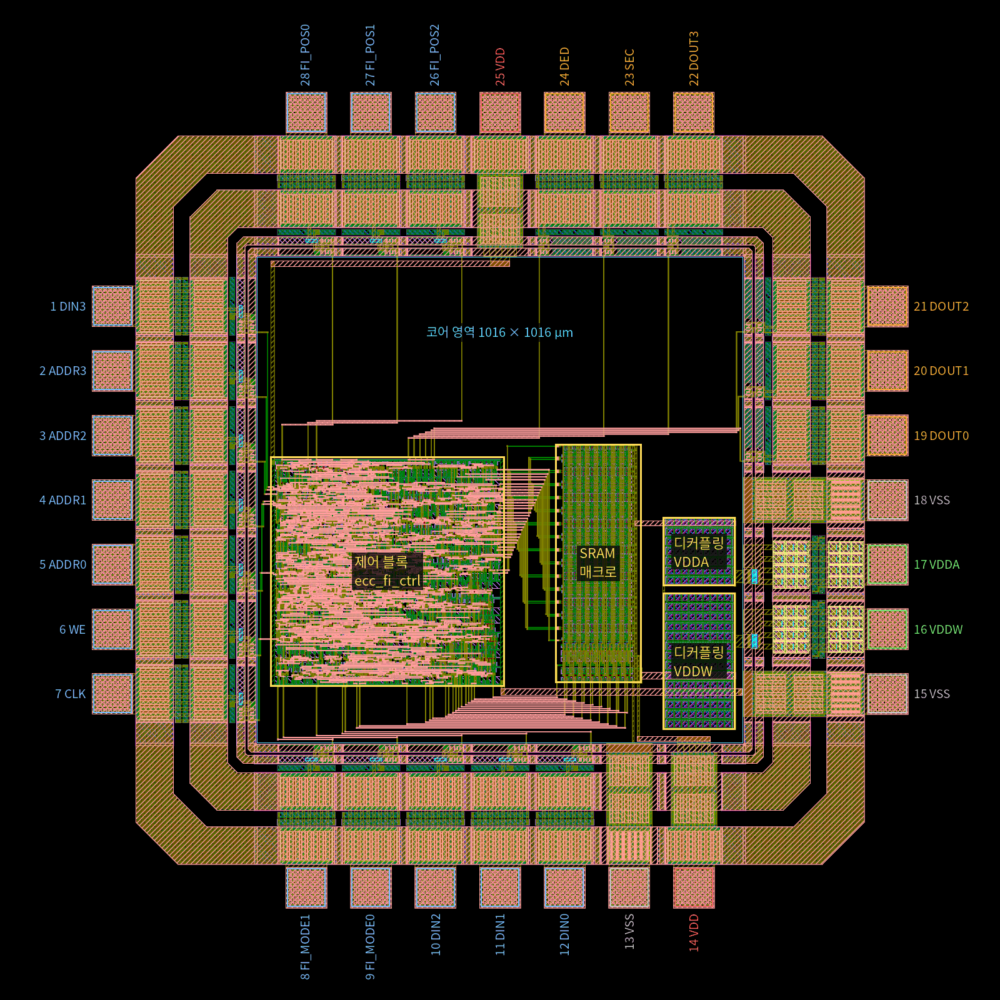
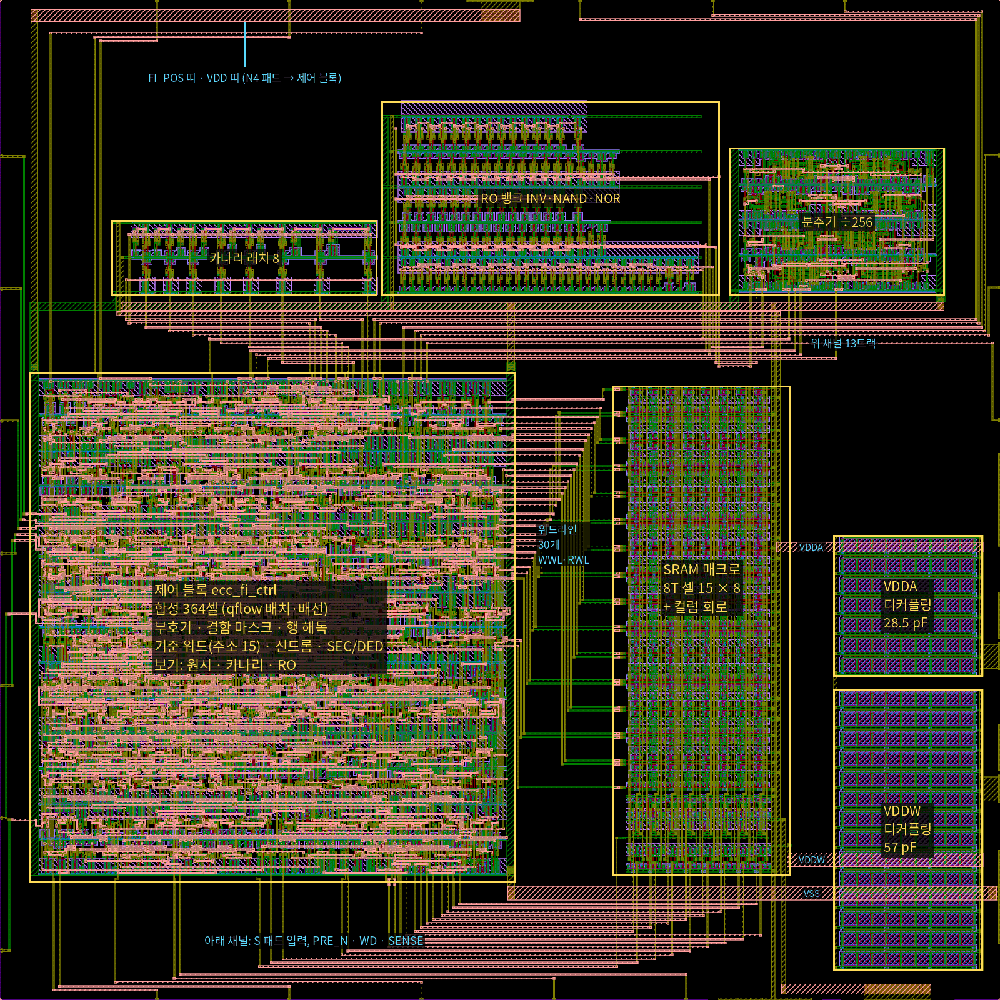
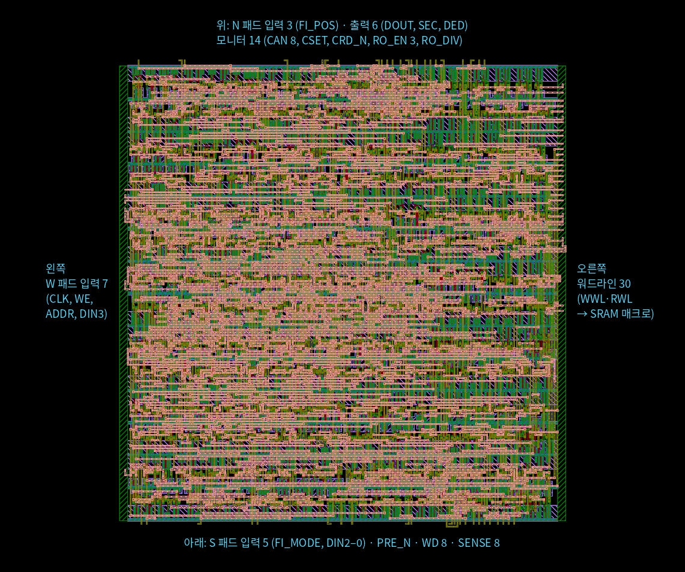
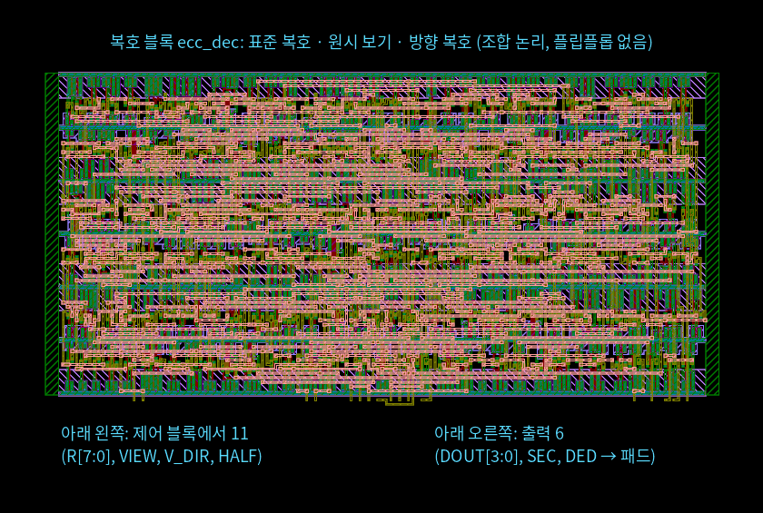
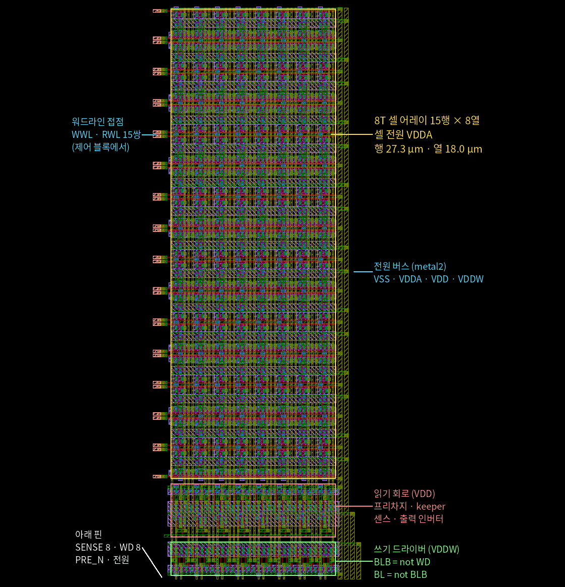
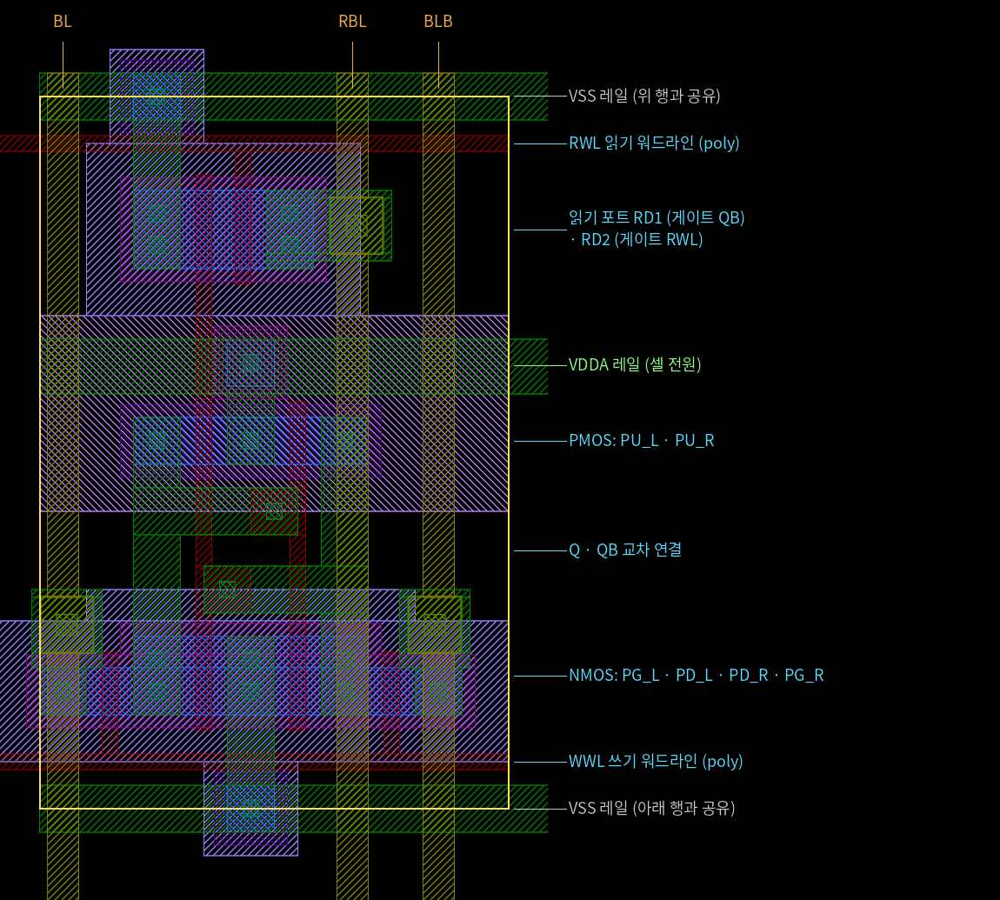
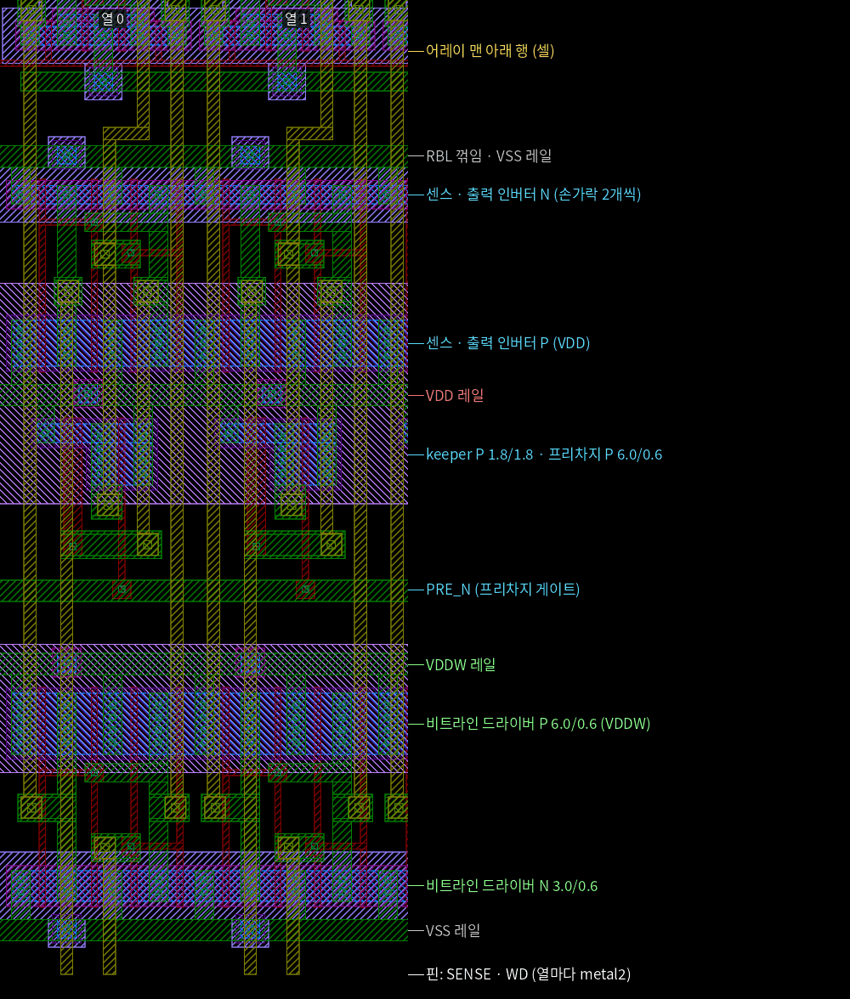

# ECC 8T SRAM 칩 안내

마이칩(ETRI 0.5 µm CMOS) 제출용 최종 GDS와 그 내용을 정리한 문서다. 칩의 주제, 각 부분이 하는 일, 검증 결과, Codespaces에서 결과물을 여는 방법을 담았다. 세부 사양은 [spec.md](spec.md), 단계별 검증 과정과 판단은 [verification.md](verification.md)에 있고, 전체를 요약한 최종 보고서는 [report.md](report.md)다.

## 1. 최종 결과물

| 파일 | 내용 |
|---|---|
| `designs/etri050/chip/final/ecc_sram_Top.gds.gz` | 제출용 칩 GDS(gzip). 최상위 셀 `ecc_sram_Top` |
| `designs/etri050/chip/final/ecc_sram_Top.gds.sha256` | 압축을 푼 GDS와 압축 파일의 sha256 |
| `designs/etri050/chip/final/check_report.txt` | 이 GDS를 만든 전체 재검사 기록(`check_all.sh --save`) |
| `designs/etri050/chip/final/ecc_sram_Top.zip` | 제출 파일(설계 DB). 안에 `ecc_sram_Top.gds` 하나(압축하지 않은 GDSII, 위 sha256과 같은 파일) |
| `designs/etri050/chip/final/ecc_sram_Top_gds_check.txt` | zip을 만든 제출 GDS 검사 기록(GDS·zip sha256) |
| `designs/etri050/chip/final/DRC_ecc_sram_Top.png`, `LVS_ecc_sram_core.png` | 신청서용 DRC·LVS 결과 화면: KLayout에서 최종 GDS와 공식 덱 결과(규칙 115개 모두 0), 코어 LVS 결과(Netgen) |

- 공정: ETRI NSPL 0.5 µm CMOS 2P3M 5 V, 28핀 패드 틀(MPW_PAD_28pin)
- GDS 범위 1705 × 1705 µm, 설계 면적(패드 셀 안쪽) 1016 × 1016 µm, 트랜지스터 게이트 5,390개(패드 셀 포함)
- 셀 계층

```
ecc_sram_Top
├── ecc_sram_core          코어 (chip/assemble.py가 조립)
│   ├── ecc_fi_ctrl_F      제어 블록: 부호기·결함 마스크·행 해독·기준 워드, qflow 배치·배선
│   ├── ecc_dec_F          복호 블록: 표준 복호·원시 보기·방향 복호(조합 논리), qflow 배치·배선
│   ├── sram_macro         8T 셀 어레이 15 × 8 + 컬럼 회로
│   ├── decap_vddw         VDDW 디커플링 57 pF
│   └── decap_vdda         VDDA 디커플링 28.5 pF
└── ecc_sram_Pad           패드 링: ETRI GPIO 패드 28개와 코너·필러 셀
```

### 1.1 신청서(2장 DB 접수 내용)에 쓰는 값

| 항목 | 값 |
|---|---|
| 설계명 | 오류 방향을 이용해 무증상 오정정을 검출하는 ECC 8T SRAM |
| 설계 DB 파일명 (Top Cell 명) | `ecc_sram_Top.zip` (Top Cell `ecc_sram_Top`) |
| 설계 사용 Tool | Magic 8.3, KLayout 0.30, Netgen 1.5, ngspice 42, Yosys 0.33, qflow(GrayWolf, Qrouter), Icarus Verilog 12 (오픈소스) |
| 표준칩 배치 (MPW_PAD_28pin) | 사용 (본딩 패드 28개가 `MPW_PAD_28pin.gds`와 XOR 0) |
| 제공한 PDK의 GPIO | 사용: PIC 15, POB8 6, PVDD 2, PVSS 3, PANA 2(VDDA·VDDW, PADR 포트), PCORNER 4, IOFILLER50 8 |
| 칩 제공 형태 | 28pin-SOP 패키지 (only) |
| 설계 면적 | 1칩 (패드 셀 안쪽 1016 × 1016 µm) |
| 사용 소자 | 코어는 NMOS·PMOS만(디커플링도 MOS 커패시터). 저항·다이오드·ESD 층은 ETRI GPIO 셀 안에만 있다 |
| Rule Check | DRC O, LVS O, PEX O. DRC: 킷 KLayout 공식 덱 + Calibre 전용 73규칙 + 규칙 7–12 + 안테나. LVS: 코어 트랜지스터 수준(Magic 추출 + Netgen). 기생 추출: 칩 코어 모의용 Magic 추출(기생 C × 1.5) |
| DRC/LVS 결과 화면 | `final/DRC_ecc_sram_Top.png`, `final/LVS_ecc_sram_core.png` |

학생·지도교수 정보와 서명은 신청서에 직접 채운다. 1장(신청 내용)의 회로 설명과 수치는 이 문서와 [report.md](report.md)를 따른다.

## 2. 칩 주제

SRAM은 전원 전압이 낮거나 셀이 약하면 저장한 값을 잃거나, 잘못 읽거나, 쓰지 못한다. ECC는 이런 비트 오류를 고치거나 검출한다. 이 칩은 작은 SRAM에 Hamming(8,4) SEC-DED를 붙이고 오류를 일부러 만들어서, ECC가 실제로 무엇을 고치고 무엇을 놓치는지 측정하는 칩이다.

오류는 두 가지 방법으로 만든다.

1. **논리 결함 주입**: 핀(FI_MODE, FI_POS)으로 고른 비트를 쓸 때(1·2·3비트) 또는 읽을 때(1·2비트) 뒤집는다. 결과가 정해져 있으므로 ECC 회로 자체를 시험한다
2. **물리 결함**: 셀 전원 VDDA와 비트라인 드라이버 전원 VDDW를 따로 핀으로 받는다. 이 둘을 낮추면 보존 실패(값을 잃음), 읽기 실패, 쓰기 실패가 실제 셀에서 생긴다. 어느 비트가 먼저 틀릴지는 셀마다 다르다(공정 편차)

원시 보기(읽기 모드 11)는 저장된 8비트를 정정 없이 그대로 읽는다. 원시 보기로 실패 비트 지도를 만들고 같은 워드의 정정 출력과 SEC/DED가 그 지도와 맞는지 비교하는 것이 측정의 중심이다.

물리 결함의 성질을 ECC 판정에 되돌려 쓰는 것이 이 칩의 둘째 축이다. VDDA를 낮춘 읽기 실패와 VDDW를 낮춘 쓰기 실패는 0이 1로만 바뀐다. **방향 보기**(읽기 모드 11, FI_POS 011)는 이 방향을 알고 같은 부호·같은 저장 비트를 다시 판정한다. 표준 SEC-DED는 한 방향 3비트 오류를 모두 틀린 값으로 고치면서 SEC만 내지만(무증상 오류), 방향 보기는 그 112가지를 모두 검출하고 데이터 0 워드의 2비트 오류는 고친다. 같은 워드를 두 복호기로 잇달아 읽어 무증상 오류가 얼마나 줄어드는지 측정한다.

- 16워드 × 8비트(데이터 4 + 검사 4) = 128비트
- 주소 0–14: 맞춤 설계한 8T 셀 행. 주소 15: 제어 블록 안의 표준셀 플립플롭 8개(기준 워드). 어레이가 동작하지 않아도 ECC와 논리 결함 주입은 주소 15로 확인할 수 있다

## 3. 칩 전체와 핀



번호는 패키지 핀 번호(반시계). 파랑 입력(PIC), 주황 출력(POB8), 빨강 VDD(PVDD), 회색 VSS(PVSS), 초록 VDDA·VDDW(PANA).

| 핀 | 신호 | 패드 셀 | 기능 | 핀 | 신호 | 패드 셀 | 기능 |
|---|---|---|---|---|---|---|---|
| 1 | DIN3 | PIC | 쓰기 데이터 3, 방향 보기 반전 켜기 | 15 | VSS | PVSS | 접지·기판 |
| 2 | ADDR3 | PIC | 주소 3 | 16 | VDDW | PANA (PADR) | 비트라인 드라이버 전원 |
| 3 | ADDR2 | PIC | 주소 2 | 17 | VDDA | PANA (PADR) | 셀 어레이 전원 |
| 4 | ADDR1 | PIC | 주소 1 | 18 | VSS | PVSS | 접지·기판 |
| 5 | ADDR0 | PIC | 주소 0 | 19 | DOUT0 | POB8 | 데이터 출력 0 |
| 6 | WE | PIC | 쓰기(1) / 읽기(0) | 20 | DOUT1 | POB8 | 데이터 출력 1 |
| 7 | CLK | PIC | 0 프리차지, 1 읽기·쓰기 | 21 | DOUT2 | POB8 | 데이터 출력 2 |
| 8 | FI_MODE1 | PIC | 결함 모드 1 | 22 | DOUT3 | POB8 | 데이터 출력 3 |
| 9 | FI_MODE0 | PIC | 결함 모드 0 | 23 | SEC | POB8 | 1비트 오류(정정함) |
| 10 | DIN2 | PIC | 쓰기 데이터 2 | 24 | DED | POB8 | 2비트 오류 검출 |
| 11 | DIN1 | PIC | 쓰기 데이터 1 | 25 | VDD | PVDD | 링·코어 전원 5 V |
| 12 | DIN0 | PIC | 쓰기 데이터 0 | 26 | FI_POS2 | PIC | 결함 위치 2 |
| 13 | VSS | PVSS | 접지·기판 | 27 | FI_POS1 | PIC | 결함 위치 1 |
| 14 | VDD | PVDD | 링·코어 전원 5 V | 28 | FI_POS0 | PIC | 결함 위치 0, 원시 보기 반쪽, 방향 보기 방향 |

패드 위치와 셀은 `designs/etri050/chip/pins.csv`가 정한다. 방향 보기(읽기 모드 11, FI_POS 011·010)에서는 DIN3 = 1이면 R의 비트 DIN[2:0]이 뒤집히므로, 일부러 뒤집을 때가 아니면 읽기 때 DIN = 0으로 둔다.

## 4. 각 부분이 하는 일

### 4.1 패드 링

- 킷의 28핀 템플릿 자리에 셀 종류만 바꿨고, 셀 내용은 ETRI GPIO 라이브러리 원본 그대로다(제출 GDS 검사에서 원본과 같음을 확인)
- PIC 입력 버퍼 15개, POB8 출력 버퍼 6개, PVDD 2개, PVSS 3개, PANA 2개
- PANA는 코어 쪽 저항 포트 PADR(약 0.7 kΩ 직렬)로 VDDA와 VDDW를 받는다. 이 핀에는 누설과 쓰기 전하만 흘러 저항 강하는 mV 수준이다
- 측정 중 입력 핀을 띄워 두지 않는다

### 4.2 코어 배치



- 왼쪽 제어 블록, 그 위 복호 블록, 가운데 SRAM 매크로, 오른쪽 디커플링 둘
- 배선은 층을 나눠 같은 층끼리 엇갈리지 않게 했다. 워드라인 30개(WWL 15, RWL 15)는 제어 블록 오른쪽 핀에서 매크로 왼쪽 접점으로 간다
- 아래 채널: S 패드 입력, 매크로로 가는 PRE_N·WD[7:0], 매크로에서 오는 SENSE[7:0]
- 위 채널(metal3 트랙 11개): 제어 블록 → 복호 블록 11넷(R[7:0], VIEW, V_DIR, HALF)과 복호 블록 → 출력 패드 6넷. N 패드 입력 3개(FI_POS)는 복호 블록 왼쪽으로 올라간다
- 전원 띠(metal3): VSS, VDD(N4 패드 → 제어 블록, S7 패드 → 매크로 VDD 버스), VDDW·VDDA(오른쪽 PANA 패드 → 디커플링 → 매크로). 복호 블록은 위 채널과 블록 사이의 띠로 제어 블록의 vdd·gnd 줄기에서 받는다

### 4.3 제어 블록 ecc_fi_ctrl



`designs/etri050/ctrl/ecc_fi_ctrl/ecc_fi_ctrl.v`를 공개 킷의 표준셀로 합성하고 qflow로 배치·배선했다. 483.6 × 517.15 µm, 핀 75개. 배치·배선 결과는 `ctrl/macro`에 고정해 두고 칩 조립에 그대로 쓴다.

| 기능 | 하는 일 |
|---|---|
| 부호기 | DIN[3:0] → 코드워드 C[7:0] = {D3, D2, D1, P2, D0, P1, P0, PALL} |
| 쓰기 결함 마스크 | 쓰기 때 FI_MODE 01 / 10 / 11 → 비트 k / k, k^1 / k, k^1, k^2를 뒤집어 저장(k = FI_POS) |
| 행 해독 | ADDR 0–14 → CLK = 1인 동안 WWL(쓰기) 또는 RWL(읽기) 하나를 5 V로 |
| 쓰기 데이터 | WD[7:0] = 저장할 코드워드 → 매크로의 비트라인 드라이버 |
| 프리차지 | PRE_N: CLK = 0일 때 읽기 비트라인 RBL을 VDD로 올린다 |
| 기준 워드 | 주소 15는 플립플롭 8개. CLK 상승에서 쓴다 |
| 읽기 결함 마스크 | 읽기 때 FI_MODE 01 / 10 → 센스 출력 뒤 비트 k / k, k^1을 뒤집는다(일시 오류). 방향 보기에서 DIN3 = 1이면 비트 DIN[2:0]을 뒤집는다 |
| 복호 블록으로 | R[7:0](읽은 워드), VIEW(FI_MODE = 11), V_DIR(방향 보기: 읽기, FI_MODE 11, FI_POS[2:1] = 01), HALF(FI_POS0) |

### 4.4 복호 블록 ecc_dec



`designs/etri050/ctrl/ecc_dec/ecc_dec.v`. 플립플롭이 없는 조합 논리라 전원을 켠 뒤 해 둘 일이 없다. 456.6 × 225.9 µm, 핀 19개(모두 아래 변). 위 채널 위에 놓여 출력 패드 6개를 직접 몬다.

| 보기 | DOUT | SEC, DED |
|---|---|---|
| 정상 읽기, 읽기 모드 00–10 | 정정한 데이터 | 표준 판정: 전체 패리티 불일치 → SEC, 신드롬 ≠ 0이고 패리티 일치 → DED |
| 원시 보기(모드 11, FI_POS 000·001·1xx) | FI_POS0 = 1이면 {R7, R6, R5, R3}, 0이면 {R4, R2, R1, R0} | 표준 판정 |
| 방향 보기(모드 11, FI_POS 011: 0 → 1, 010: 1 → 0) | 방향 복호로 고친 데이터 | 00 오류 없음, 10 한 비트 고침, 11 두 비트 고침, 01 검출 |

방향 복호는 틀릴 수 있는 비트 U(0 → 1이면 R의 1들)만 고친다. 전체 패리티가 틀리면 신드롬 자리가 U에 있을 때만 고치고, 패리티가 맞는데 신드롬이 0이 아니면 U가 정확히 두 비트일 때 그 둘을 고친다. 나머지는 검출이다. 1비트 오류는 표준 복호처럼 고치고, 한 방향 3비트 오류는 표준 복호가 모두 오정정하지만 방향 복호는 모두 검출한다([spec.md](spec.md)의 표).

### 4.5 SRAM 매크로



- 8T 셀 15행 × 8열(셀 18.0 × 27.3 µm) 아래에 열마다 컬럼 회로를 붙였다. 181.5 × 498.9 µm
- 셀은 VDDA, 읽기 회로는 VDD, 쓰기 드라이버는 VDDW. 세 전원을 매크로 오른쪽 버스로 따로 받는다
- 레이아웃은 `gen/sram8t.py`, `gen/colper.py`가 사각형 좌표를 계산해 Magic으로 그린다. 같은 코드가 LVS용 넷리스트도 쓴다

#### 8T 셀



- 6T 저장부(PU, PD, PG)와 읽기 포트 2개(RD1 게이트 QB, RD2 게이트 RWL)
- W/L(µm): PU 1.8/0.6, PD 3.0/0.6, PG 1.8/0.6, RD1·RD2 3.0/0.6
- 쓰기: WWL = 1이면 PG가 BL·BLB를 Q·QB에 잇는다
- 읽기: RWL = 1이면 Q = 0인 셀이 RBL을 끌어내린다(RBL은 Q를 따른다). 읽기 전류가 저장 노드를 거치지 않아 읽는다고 값이 뒤집히지 않는다

#### 컬럼 회로



- 읽기(VDD): 프리차지 P(게이트 PRE_N)가 CLK = 0 동안 RBL을 올리고, keeper P(게이트 SB)가 RBL의 높은 값을 약하게 붙잡는다. 센스 인버터 → SB → 출력 인버터 → SENSE(Q와 같은 극성)
- 쓰기(VDDW): BLB = not WD, BL = not BLB. 드라이버는 항상 켜져 있고 쓰기는 선택된 행의 WWL만으로 정해진다. VDDW가 쓸 때 비트라인의 높은 값이다
- 인버터는 손가락 2개씩이고 소스를 이웃 열과 나눠 써서 열 간격 18 µm 안에 들어간다

### 4.6 전원과 디커플링

| 전원 | 핀 | 쓰는 곳 | 평소 | 실험 |
|---|---|---|---|---|
| VDD | 14, 25 | 패드, 제어·복호 블록, 읽기 회로 | 5 V | 고정 |
| VDDA | 17 | 셀 어레이 | 5 V | 보존·읽기 실험에서 낮춤 |
| VDDW | 16 | 비트라인 드라이버 | 5 V | 쓰기 실험에서 낮춤 |

- VDDA·VDDW는 PADR 저항을 거쳐 들어오므로, 쓰기 때 비트라인을 충전하는 순간 전하는 칩 안 디커플링(NMOS 게이트 커패시터, VDDW 57 pF, VDDA 28.5 pF)이 댄다
- VDDA·VDDW는 VDD보다 높이지 않는다(PANA의 ESD 다이오드가 VDD 쪽으로 켜진다). VDD를 먼저 켜고 VDDA·VDDW를 나중에 켠다

### 4.7 타이밍

- CLK = 0: 읽기 비트라인 프리차지. ADDR, WE, DIN, FI_*는 CLK = 0일 때만 바꾼다
- CLK = 1: 선택된 행 읽기 또는 쓰기. 읽기 출력은 CLK = 1인 동안 유효하다(CLK = 0 동안은 프리차지 값 1111)
- 기준 워드(주소 15)는 CLK 상승에서 쓴다
- 측정 클록은 수 kHz–1 MHz면 충분하다. 칩 모의는 주기 200 ns로 확인했다

### 4.8 물리 결함 실험 요약

| 실험 | 조건 | 실패 모양 | 모의 기준값 |
|---|---|---|---|
| 보존 | 5 V에서 쓰고 VDDA = VDDW를 V_hold로 30 s 이상(유지 중 FI_MODE = 00, DIN = 쓴 데이터), 5 V로 올려 읽기 | 저장값을 잃음(셀마다 기우는 쪽, 양방향) | 보존 전압 TT 0.37 V |
| 읽기 Vmin | VDDA를 낮춘 채 읽기(VDDW = VDDA) | 0이 1로 읽힘(0 → 1만) | TT 1.42 V |
| 쓰기 Vmin | VDDA = 5 V, VDDW를 낮추며 쓰고 5 V에서 읽기(VDDW ≥ 1 V) | 1 위에 0을 못 씀(0 → 1만) | TT 약 1.35 V, 코너 1.2–1.5 V(추출한 매크로) |

보존 실험은 두 패턴(값과 반전)을 모두 본다. 읽기·쓰기 Vmin 실험에서는 같은 워드를 정상 읽기, 방향 보기(FI_POS 011), 원시 보기 두 반쪽으로 잇달아 읽어 맞음·검출·무증상 오류로 나눈다(워드마다 다른 데이터, VDDA 1 mV 단계). 자세한 절차는 [spec.md](spec.md)의 측정 계획.

## 5. 검증 결과

최종 GDS는 `designs/etri050/chip/check_all.sh --save`가 소스에서 모든 블록과 칩을 다시 만들고 아래 검사를 모두 통과했을 때만 저장한다. 기록은 `final/check_report.txt`. 제출 zip은 저장한 GDS를 풀어 제출 GDS 검사를 다시 통과시켜 만들었고(`final/ecc_sram_Top_gds_check.txt`), 검사기 자체 시험 11가지도 이 GDS로 모두 기대대로 나왔다.

| 대상 | 검사 | 도구 | 결과 |
|---|---|---|---|
| 제어 블록 + 복호 블록 | 칩 코어 논리 테스트벤치(RTL, 게이트 수준, 배치 후, 고정 넷리스트) | Icarus Verilog | 통과(235,865회 비교, 그중 방향 보기 30,206회. 그밖에 프리차지 구간 14,094회) |
| 복호 블록 | 입력 11비트 2,048가지 전수 테스트벤치(같은 넷리스트들) | Icarus Verilog | 통과 |
| 두 블록 RTL | 틀린 RTL 14개가 모두 시험에 걸리는지 | `ctrl/mutants.py` | 14개 모두 걸림 |
| 제어 블록, 복호 블록 | 평면 LVS, 공식 DRC, 추가 규칙 | Magic + Netgen, KLayout | 일치, 0, 0 |
| 8T 셀·어레이, SRAM 매크로, 디커플링 | Magic DRC, 공식 DRC, LVS, 추가 규칙 | Magic, KLayout, Netgen | 0, 0, 일치, 0 |
| 패드 링 | 공식 DRC | KLayout | 0 |
| 칩 전체 | 공식 DRC(킷이 ETRI Calibre 덱을 옮긴 KLayout 덱) | KLayout | 0 |
| 칩 전체 | Calibre 덱에만 있는 73규칙 | `scripts/calibre_rules.py` | 0 |
| 칩 전체 | 규칙 7–12, 규칙 문서 값 | `scripts/metal_rules.py` | 64, 모두 ETRI GPIO 셀 안(패드 링만 검사해도 같은 자리), 코어 0 |
| 칩 전체 | 안테나 규칙(다이오드 몫 없이) | `scripts/antenna_rules.py` | 0 |
| 코어 | 트랜지스터 수준 LVS | Magic 추출 + Netgen | 일치, 3,982 소자 · 1,909 넷 |
| 코어 | 기판·우물 접점이 금속으로 전원 패드에 이어지는지 | `scripts/tap_check.py` | 모두(p+ 4,019개 VSS, n+ 4,676개 VDD·VDDA·VDDW) |
| 칩 전체 | 접촉이나 패드에 이어지지 않은 금속 조각(최종 GDS에 따로 돌림) | `scripts/float_metal.py` | 0(금속 넷 1,269개) |
| 최종 GDS | 제출 GDS 검사(셀 이름, 층, 0.01 µm 격자, 스크라이브 레인, 패드 개구, GPIO 원본, 기판 접속) | `scripts/mychip_gds_check.py` | 통과, 실패 0 · 경고 0 |

모의 결과:

| 대상 | 내용 | 결과 |
|---|---|---|
| 8T 셀 | 코너·온도·전압 45조건 쓰기·읽기, 보존 전압, 읽기·쓰기 Vmin | 모두 통과, 기준값은 4.7절 |
| SRAM 매크로 | 그린 매크로 추출(기생 C × 1.5) 후 5 코너와 VDDA·VDDW 2.0 V | 240비트씩 오류 0 |
| 칩 코어 | 최종 GDS의 코어 전체 추출(소자 4,236 + 기생 C 12,041), 쓰기·결함 주입·읽기 37주기를 ECC 모델과 비교 | 아래 표 |
| 칩 코어 | 같은 추출로 전원 전류(FF 0 °C, 5.5 V, 주기 200 ns) | VDD 평균 0.92 mA, VDDW 57 µA, VDDA 4.8 µA. 가정 전류 밀도 한계 1 mA/µm 아래 |

칩 코어 모의는 배열 워드, 기준 워드(주소 15), 저장 결함 1·2·3비트를 쓴 뒤 읽기 25번을 정상 읽기, 원시 보기 두 반쪽, 일시 결함 1·2비트, 방향 보기(두 방향, DIN 반전 포함)로 나눠 하고 DOUT·SEC·DED를 ECC 모델과 비교한다. 방향 보기 읽기에는 데이터 0의 2비트 저장 오류(고침, {SEC, DED} = 11), 3비트 저장 오류(정상 읽기는 틀린 값 + SEC, 방향 보기는 검출 01), 데이터 F의 1 → 0 2비트 오류(1 → 0 보기는 고침, 0 → 1 보기는 검출)가 들어 있다. 입력은 패드의 코어 쪽에서 넣는다.

| 조건 | 읽기 25번 |
|---|---|
| TT 27 °C, 5 V | 모두 맞음 |
| SS 125 °C, 4.5 V | 모두 맞음 |
| FF 0 °C, 5.5 V | 모두 맞음 |
| TT 27 °C, VDD 5 V, VDDA = VDDW = 2.0 V | 모두 맞음 |

올린 브랜치를 새로 받아 소스에서 칩을 다시 만들면 모든 검사를 다시 통과하고, 최종 GDS와 19개 층 모두 XOR 0이다(6.6절).

## 6. Codespaces에서 결과물 보기

### 6.1 Codespace 만들기

1. 저장소 페이지에서 **Code → Codespaces → ⋯ → New with options**. Branch `main`, Machine type은 4-core를 권장한다(2-core도 된다). **Create codespace**
2. 처음 한 번은 이미지(IIC-OSIC-TOOLS 2026.10)를 받고 `scripts/setup-all.sh`가 ETRI 킷, PDK 모델, qflow를 설치한다. 진행은 명령 팔레트(Ctrl+Shift+P)의 **Codespaces: View Creation Log**에서 보이고, `[setup] done.`이 나오면 끝이다
3. 새 터미널을 연다. `klayout-etri` 같은 셸 함수가 `~/.bashrc`로 들어온다. 점검은 `bash scripts/smoke-test.sh`

### 6.2 데스크톱(noVNC) 열기

1. 아래 패널 **Ports** 탭에서 6080 "EDA Desktop (noVNC)"의 지구본 아이콘(Open in Browser)을 누른다. Codespace가 처음 시작될 때 한 번 자동으로 열리기도 한다
2. noVNC 화면에서 Connect를 누르고 비밀번호 `abc123`(파일 목록이 보이면 `vnc.html`을 누른다)
3. 데스크톱이 뜨지 않으면 터미널에서 `bash .devcontainer/start-desktop.sh`

VS Code 터미널에서 실행한 GUI 프로그램(KLayout, Magic)은 이 데스크톱에 창이 뜬다(`DISPLAY=:1`).

### 6.3 KLayout으로 최종 GDS 보기

```bash
gunzip -k designs/etri050/chip/final/ecc_sram_Top.gds.gz
klayout-etri designs/etri050/chip/final/ecc_sram_Top.gds
```

- `klayout-etri`는 ETRI 층 색(`ETRI050_CMOS.lyp`)과 모든 계층 보기로 KLayout을 연다
- F2 전체 보기, 마우스 휠 확대·축소, `*` 모든 계층, `1` 최상위 셀만
- 왼쪽 Cells 창에서 셀을 오른쪽 클릭 → **Show As New Top**으로 그 블록만 본다(`ecc_fi_ctrl_F`, `ecc_dec_F`, `sram_macro`, `decap_vddw`, `decap_vdda`, `ecc_sram_Pad`)
- 오른쪽 Layers 창에서 층을 켜고 끈다. MET3(36/0)을 끄면 그 아래 배선과 셀이 잘 보인다
- 길이는 도구 막대의 Ruler로 잰다
- 좌표(µm): 패드 틀 (97.5, 97.5)–(1802.5, 1802.5), 코어 (442, 442)–(1458, 1458), 제어 블록 (470, 560)–(953.6, 1077.15), 복호 블록 (560, 1150.2)–(1016.6, 1376.1), SRAM 매크로 (1065, 567.4)–(1246.5, 1066.3)

공식 DRC를 직접 돌려 결과를 KLayout에서 보려면:

```bash
etri-drc-klayout designs/etri050/chip/final/ecc_sram_Top.gds /tmp/ecc_sram_Top_drc.lyrdb
klayout-etri designs/etri050/chip/final/ecc_sram_Top.gds -m /tmp/ecc_sram_Top_drc.lyrdb   # Tools → Marker Browser
```

### 6.4 블록을 Magic으로 보기

블록 레이아웃(`.mag`)은 생성기를 돌리면 `designs/etri050/sram/build`에 생긴다(`check_all.sh`를 돌렸으면 이미 있다).

```bash
python3 designs/etri050/gen/colper.py --check        # sram_macro (8T 셀 어레이 + 컬럼 회로)
cd designs/etri050/sram/build && magic-etri sram_macro
```

`sram8t`(셀), `sram_array`(어레이), `decap_vddw`, `decap_vdda`도 같은 폴더에 있다.

### 6.5 데스크톱 없이 그림으로 보기

- 이 문서의 그림은 `python3 scripts/doc_figures.py`가 최종 GDS와 블록 GDS에서 다시 그린다(`docs/img`)
- 원하는 범위만 PNG로 그리기:

```bash
klayout -b -r scripts/render_gds.py -rd gds=designs/etri050/chip/final/ecc_sram_Top.gds \
    -rd png=/tmp/core.png -rd lyp=$ETRI050_LYP -rd box=442,442,1458,1458 -rd width=1600
```

PNG는 VS Code 탐색기에서 누르면 바로 보인다(`/tmp`에 그렸다면 `code /tmp/core.png`).

### 6.6 다시 검사하기

```bash
# 저장소의 최종 GDS가 기록된 것과 같은지 (gunzip -k 뒤에)
(cd designs/etri050/chip/final && sha256sum -c ecc_sram_Top.gds.sha256)

# 제출 zip 안의 GDS가 같은 파일인지
unzip -p designs/etri050/chip/final/ecc_sram_Top.zip ecc_sram_Top.gds | sha256sum

# 제출 zip을 다시 만들기 (zip 안 파일 시각이 들어가 zip의 sha256은 달라진다)
python3 scripts/mychip_gds_check.py designs/etri050/chip/final/ecc_sram_Top.gds --top ecc_sram_Top \
    --zip designs/etri050/chip/build/ecc_sram_Top.zip --report designs/etri050/chip/build/ecc_sram_Top_gds_check.txt

# 소스에서 블록과 칩을 다시 만들고 모든 검사 (2-core에서 7–9분) → designs/etri050/chip/build/check_report.txt
bash designs/etri050/chip/check_all.sh

# 다시 만든 GDS와 최종 GDS의 도형 비교: 층마다 XOR 면적이 0이면 같은 칩
# (GDS 머리의 날짜가 달라 sha256은 다르게 나온다. Magic 8.3.105로 만들면 블록 안 포트 이름 글자 55개도 더 들어간다)
klayout -b -r scripts/gds_xor.py -rd a=designs/etri050/chip/build/ecc_sram_Top.gds \
    -rd b=designs/etri050/chip/final/ecc_sram_Top.gds

# 칩 코어 트랜지스터 모의 (추출 + ngspice, 조건 하나에 약 30분)
python3 designs/etri050/sim/chip/chip_sim.py
python3 designs/etri050/sim/chip/chip_sim.py --no-extract --corner SS --temp 125 --vdd 4.5 --vdda 4.5 --vddw 4.5
```

## 7. 소스 위치

| 부분 | 소스 | 만들기·검사 |
|---|---|---|
| 8T 셀·어레이 | `designs/etri050/gen/sram8t.py` | `python3 designs/etri050/gen/sram8t.py all --check` |
| 컬럼 회로·SRAM 매크로 | `designs/etri050/gen/colper.py` | `python3 designs/etri050/gen/colper.py --check` |
| 디커플링 | `designs/etri050/gen/decap.py` | `python3 designs/etri050/gen/decap.py --check` |
| 제어 블록, 복호 블록 | `designs/etri050/ctrl/` (RTL `ecc_fi_ctrl/`, `ecc_dec/`, 테스트벤치 `tb/`, qflow), `ctrl/macro/` (고정 결과) | `make -C designs/etri050/ctrl sim dec_sim gatesim macrosim mutants` |
| 패드 링 | `designs/etri050/chip/pins.csv`, `pad_ring.py`, `pad_gds.py` | `bash designs/etri050/chip/run_pad_ring.sh` |
| 칩 조립 | `designs/etri050/chip/assemble.py` | `python3 designs/etri050/chip/assemble.py` |
| 칩 검사 | `designs/etri050/chip/check_all.sh`, `core_lvs.py`, `scripts/extra_checks.sh`, `scripts/tap_check.py`, `scripts/mychip_gds_check.py` | 6.6절 |
| 모의 | `designs/etri050/sim/cell/`, `sim/post/`, `sim/chip/` | README의 실행 절 |
