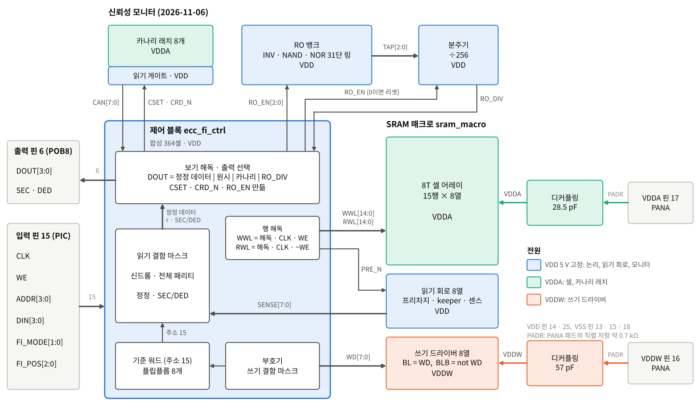
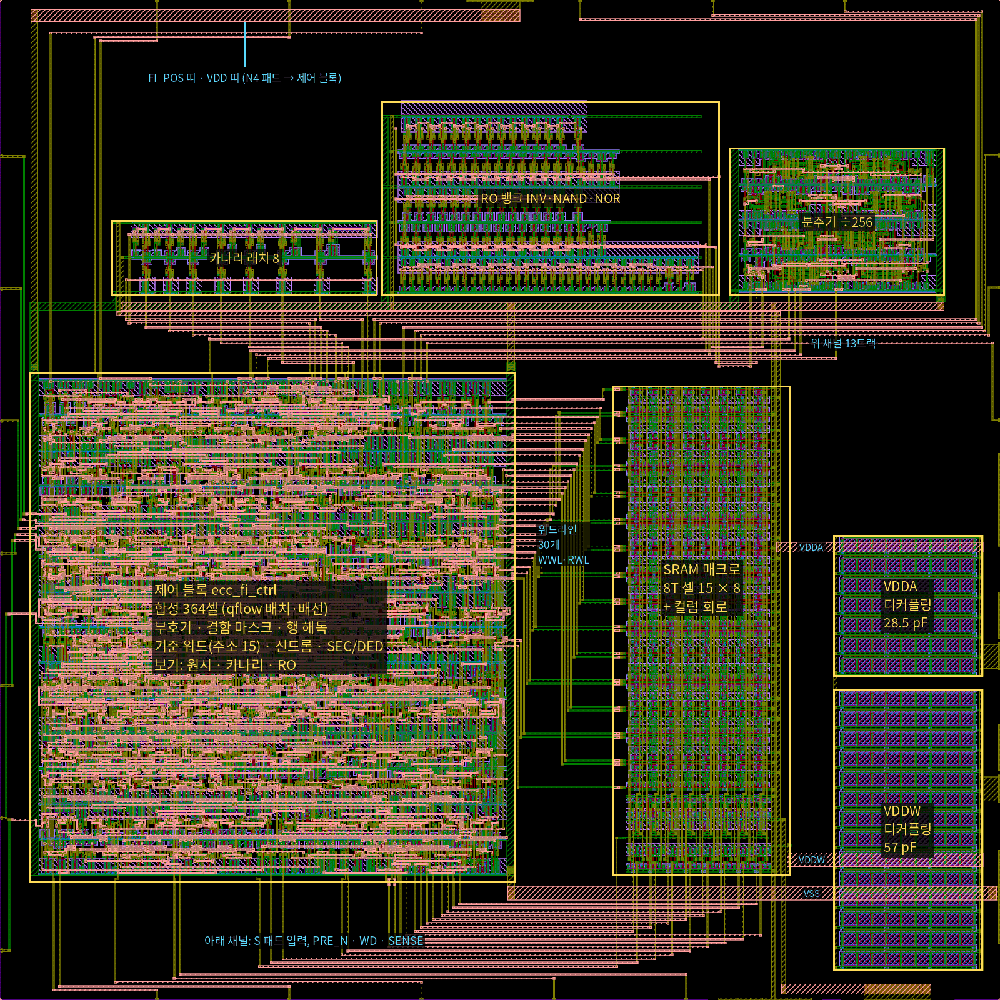
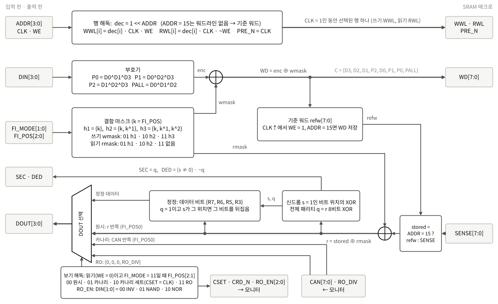
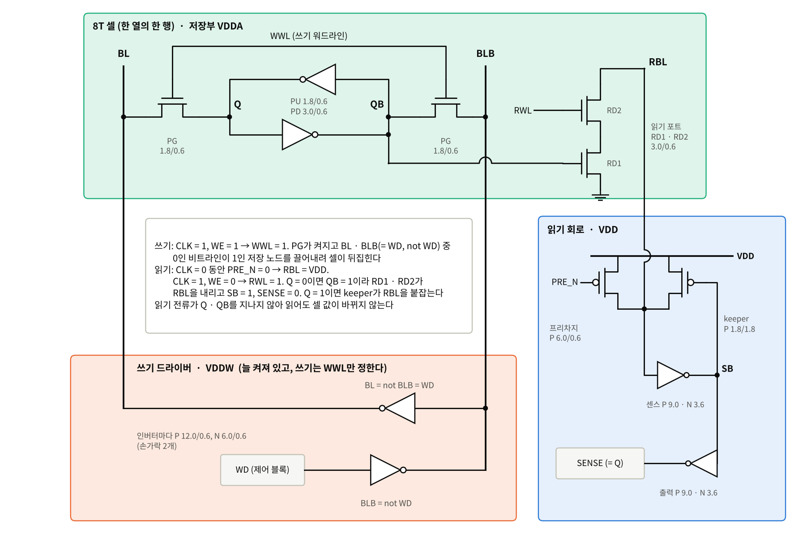
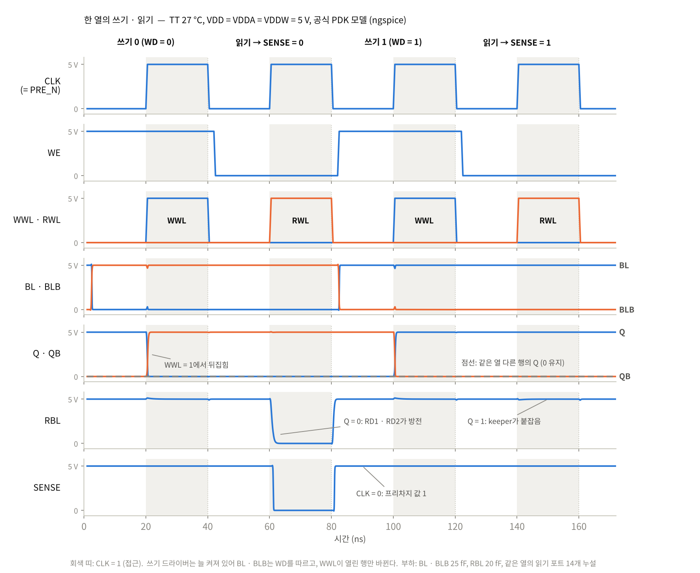
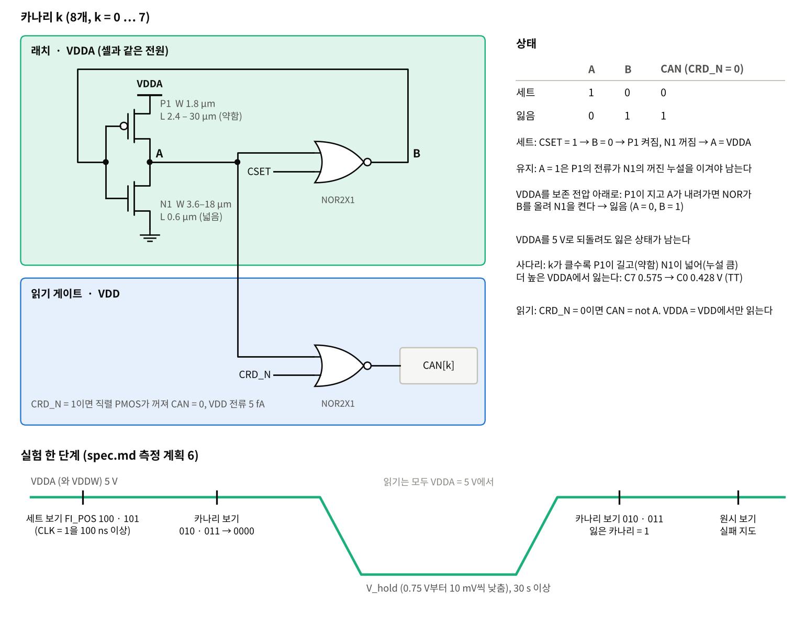
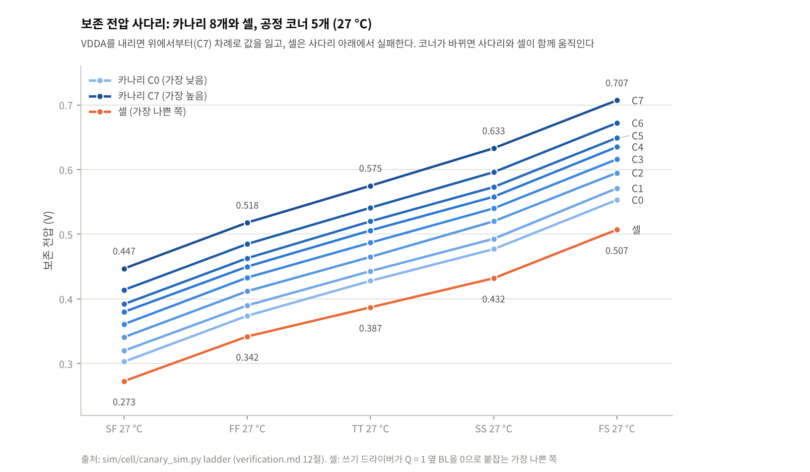
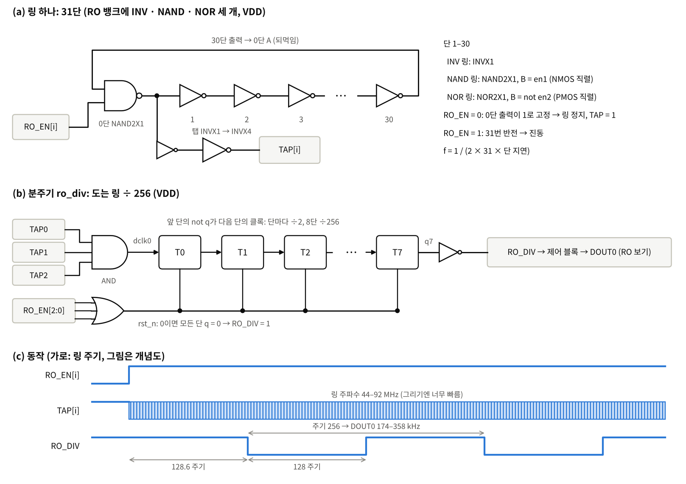
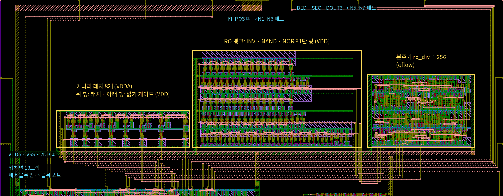

# 회로 구조와 동작

칩이 어떤 블록으로 되어 있고 각 블록을 어떻게 만들었는지, 한 클록 주기 안에서 신호가 어떻게 움직이는지 설명한다. 2026-11-06에 코어 위쪽 빈 곳에 넣은 신뢰성 모니터(카나리 래치, RO 뱅크, 분주기)가 무엇을 하고 어떻게 동작하는지도 여기서 다룬다. 핀·모드 표는 [spec.md](spec.md), 레이아웃 그림과 검사 결과는 [guide.md](guide.md), 모니터의 후보 비교와 검토는 [monitor.md](monitor.md), 단계별 수치는 [verification.md](verification.md)에 있다.

이 문서의 그림은 `python3 scripts/doc_diagrams.py`가 그린다. 5.1절의 파형은 그 스크립트가 ngspice와 PDK 모델로 직접 모의한 결과다.

## 1. 전체 구조



논리는 모두 제어 블록 하나에 모아 RTL에서 합성했다(분주기도 같은 방법). 셀과 비트라인 회로, 디커플링, 카나리, RO 뱅크는 생성기 코드로 그렸다.

| 블록 | GDS 셀 | 크기 (µm) | 전원 | 하는 일 |
|---|---|---|---|---|
| 제어 블록 | `ecc_fi_ctrl_F` | 495.9 × 520.05 (합성 364셀, 배치 후 버퍼 포함 485셀) | VDD | 부호화, 결함 주입, 행 해독, 기준 워드, 신드롬·정정·판정, 출력 선택, 모니터 제어 |
| SRAM 매크로 | `sram_macro` | 181.5 × 498.9 | VDDA(셀), VDD(읽기 회로), VDDW(쓰기 드라이버) | 15워드 × 8비트 저장, 읽기 비트라인 프리차지·센스, 쓰기 구동 |
| 디커플링 | `decap_vdda`, `decap_vddw` | 152.4 × 143.7, 152.4 × 286.5 | VDDA, VDDW | 28.5 pF, 57 pF. PANA 패드의 직렬 저항(PADR, 약 0.7 kΩ) 너머에서 쓰기 전하를 댄다 |
| 카나리 래치 | `canary_flat` | 270.6 × 76.8 | VDDA(래치), VDD(읽기 게이트) | 보존 실패 조기 경보 (7.3절) |
| RO 뱅크 | `robank_flat` | 345.1 × 198.9 | VDD | INV·NAND·NOR 31단 링, 다이의 공정 코너 (7.4절) |
| 분주기 | `ro_div_F` | 219.6 × 150.9 | VDD | 도는 링 ÷ 256 → DOUT0 (7.4절) |
| 패드 링 | `ecc_sram_Pad` | GDS 1705 × 1705 | VDD, VSS | 입력 PIC 15, 출력 POB8 6, PVDD 2, PVSS 3, PANA 2 |

### 1.1 설계 방향

1. **실험 대상만 따로 낮춘다.** 셀(VDDA)과 쓰기 드라이버(VDDW)만 별도 핀으로 받고, 해독·읽기 회로·ECC·출력은 VDD 5 V에 둔다. 전압을 낮춰 생기는 오류는 셀에서만 생기고, 그것을 판정하는 회로는 늘 정상 전압에서 돈다
2. **논리 결함과 물리 결함을 같은 판정기로 본다.** 핀으로 넣은 결함(어느 비트가 틀렸는지 앎)과 전압으로 만든 결함(어느 셀이 먼저 틀릴지 모름)을 같은 신드롬·정정 회로가 판정한다. 원시 보기는 저장된 8비트를 정정 없이 보여 주므로, 물리 결함에서도 실제로 틀린 비트와 ECC의 판정을 비교할 수 있다
3. **실패 셋을 서로 다른 손잡이로 만든다.** 보존 실패는 VDDA를 낮춰 둔 뒤 5 V에서 읽고, 읽기 실패는 VDDA를 낮춘 채 읽고, 쓰기 실패는 VDDW를 낮춘 채 쓴다(5.4절)
4. **주소 15는 표준셀 플립플롭이다.** 기준 워드는 제어 블록(VDD) 안에 있다. 어레이가 동작하지 않아도 ECC와 논리 결함 주입을 시연할 수 있고, VDDA 실험 중에도 값을 잃지 않는 대조 워드가 된다
5. **클록 위상 둘로만 움직인다.** CLK = 0이면 프리차지하고 입력을 바꾸고, CLK = 1이면 접근한다. 워드라인은 해독 결과와 CLK, 그리고 WE(쓰기 WWL) 또는 ~WE(읽기 RWL)의 AND이고, 센스 활성 신호나 자체 타이밍 회로가 없다. keeper가 읽기 비트라인의 1을 정적으로 붙잡으므로 클록이 느려도(kHz) 동작한다
6. **8T 셀.** 읽기 전류가 저장 노드를 지나지 않는다(읽기 포트 RD1·RD2). 읽어도 값이 바뀌지 않으므로(모의 교란 최대 1.5 mV) 보존 실험 뒤 몇 번이고 읽어 실패 지도를 만들 수 있다
7. **쓰기 드라이버는 늘 켜져 있다.** 쓰기 여부는 선택된 행의 WWL만 정한다. 제어 신호가 하나 줄고, 쓸 때 비트라인의 높은 값이 곧 VDDW라 쓰기 실험의 손잡이가 된다
8. **새 핀 없이 모니터를 읽는다.** 28핀이 모두 쓰였다. 읽기 모드 11(원시 보기)의 FI_POS 두 비트를 보기 선택으로 써서 기존 DOUT으로 읽는다(7.2절)

### 1.2 만든 방법

| 블록 | 만든 방법 | 블록 검사 |
|---|---|---|
| 8T 셀·어레이, 컬럼 회로, 디커플링 | 파이썬 생성기(`gen/sram8t.py`, `gen/colper.py`, `gen/decap.py`)가 λ = 0.3 µm 격자의 사각형을 계산해 Magic으로 그리고, 같은 코드가 LVS용 넷리스트를 쓴다 | Magic DRC, 킷 KLayout DRC, LVS, 추가 규칙 |
| 카나리, RO 뱅크 | `gen/canary.py`, `gen/robank.py`가 킷 표준셀을 줄지어 놓고(`gen/stdrow.py`) 사각형으로 배선한다. 카나리의 약한 인버터(CINV)는 직접 그린다 | 같음 |
| 제어 블록, 분주기 | Verilog RTL → yosys 합성(킷 표준셀) → qflow 배치·배선 → 금속 틈 메우기, 0.01 µm 격자 맞추기 → `ctrl/macro`에 고정 | RTL·게이트·배치 후·고정 넷리스트 시험, 평면 LVS, DRC |
| 패드 링 | 킷 28핀 템플릿 자리에 셀 종류만 바꾼다(ETRI GPIO 원본) | DRC, 제출 GDS 검사 |
| 칩 조립 | `chip/assemble.py`: 블록 배치, 워드라인·채널 배선(제약 있는 left-edge), 전원 띠, qflow가 핀 줄 밖에 남긴 배선 피하기 | 칩 DRC·Calibre 전용 규칙·규칙 7–12·안테나, 코어 LVS, 제출 GDS 검사, 코어 전체 트랜지스터 모의 |

### 1.3 배치



| 블록 | 좌표 (µm, 왼쪽 아래 – 오른쪽 위) |
|---|---|
| 코어 | (442, 442) – (1458, 1458) |
| 제어 블록 | (470, 560) – (965.9, 1080.05) |
| SRAM 매크로 | (1065, 567.4) – (1246.5, 1066.3) |
| 디커플링 VDDW · VDDA | 왼쪽 아래 (1290, 470) · (1290, 770) |
| 카나리 | (554, 1158.2) – (824.6, 1235.0) |
| RO 뱅크 | (829, 1158.2) – (1174.1, 1357.1) |
| 분주기 | (1184, 1158.2) – (1403.6, 1309.1) |

- 워드라인 30개(WWL 15, RWL 15)는 제어 블록 오른쪽 핀에서 매크로 왼쪽 행 접점으로 간다(트랙 x 968부터)
- 아래 채널: S 패드 입력, 매크로로 가는 PRE_N·WD[7:0], 매크로에서 오는 SENSE[7:0]
- 위 채널(y 1086–1134, metal3 13트랙): 출력 6개(DOUT[3:0], SEC, DED)와 모니터 신호 17개(CSET, CRD_N, RO_EN[2:0], CAN[7:0], RO_DIV, TAP[2:0]). CAN7만 블록 포트가 제어 블록 핀 바로 위라 트랙 없이 곧게 올라간다
- FI_POS 셋은 채널 트랙을 쓰지 않고 카나리 왼쪽으로 곧게 올라가 맨 위 띠(y 1418–1426)로 N 패드에 간다
- 모니터 아래 전원 띠(y 1138–1151): VDDA(metal3), VSS(metal3), VDD(metal1). 카나리의 래치 행(VDDA)과 읽기 행(VDD)은 N-well이 40.2 µm 떨어져 있다

## 2. 핀과 전원

| 신호 | 핀 | 동작에서 하는 일 |
|---|---|---|
| CLK | 7 | 0: 프리차지, 입력 변경. 1: 읽기 또는 쓰기. 기준 워드는 상승에서 쓴다 |
| WE | 6 | 1 쓰기, 0 읽기 |
| ADDR[3:0] | 2–5 | 0–14 어레이 행, 15 기준 워드 |
| DIN[3:0] | 1, 10–12 | 쓰기 데이터. RO 보기에서는 DIN[1:0]가 링을 고른다 |
| FI_MODE[1:0] | 8, 9 | 결함 모드. 읽기에서 11이면 보기 |
| FI_POS[2:0] | 26–28 | 결함 위치 k. 보기에서는 FI_POS[2:1]이 보기, FI_POS0이 반쪽 |
| DOUT[3:0] | 19–22 | 정정 데이터 또는 보기 내용 |
| SEC, DED | 23, 24 | 그 주소 워드의 판정 |
| VDD | 14, 25 | 5 V 고정 |
| VSS | 13, 15, 18 | 접지·기판 |
| VDDA | 17 | 셀 어레이, 카나리 래치. 보존·읽기 실험에서 낮춘다 |
| VDDW | 16 | 쓰기 드라이버. 쓰기 실험에서 낮추고, 보존 실험에서는 VDDA와 함께 낮춘다 |

- 전원은 VDD를 먼저 켜고 VDDA·VDDW를 나중에 켠다. VDDA·VDDW는 VDD보다 높이지 않는다(PANA의 ESD 다이오드가 VDD 쪽으로 켜진다)
- 입력은 측정 중 띄워 두지 않는다

## 3. 제어 블록



RTL은 `designs/etri050/ctrl/ecc_fi_ctrl/ecc_fi_ctrl.v`. 클록으로 값을 붙잡는 것은 기준 워드의 플립플롭 8개뿐이고 나머지는 조합 논리다. 입력과 SENSE가 정해지면 출력도 곧바로 정해진다.

### 3.1 부호

| 코드워드 비트 | C7 | C6 | C5 | C4 | C3 | C2 | C1 | C0 |
|---|---|---|---|---|---|---|---|---|
| 내용 | D3 | D2 | D1 | P2 | D0 | P1 | P0 | PALL |
| 위치 (이진) | 111 | 110 | 101 | 100 | 011 | 010 | 001 | 전체 패리티 |

- 위치 1–7은 Hamming(7,4)의 순서다. Pj는 위치 번호의 비트 j가 1인 자리들의 패리티를 짝수로 맞춘다: P0(C1)는 C3·C5·C7(D0^D1^D3), P1(C2)은 C3·C6·C7(D0^D2^D3), P2(C4)는 C5·C6·C7(D1^D2^D3)
- PALL(C0)은 C7–C1 전체의 XOR(= D0^D1^D2)이라 정상 코드워드는 8비트 패리티가 늘 짝수다

판정은 저장된 8비트(읽기 결함 마스크를 거친 r)로 한다.

- 신드롬 s = {R4^R5^R6^R7, R2^R3^R6^R7, R1^R3^R5^R7} = 1인 비트들의 위치를 XOR한 값. 위치 i 한 비트만 틀리면 s = i
- 전체 패리티 q = 8비트 전체의 XOR. 정상이면 0, 홀수 개가 틀리면 1

| q | s | 판정 | SEC | DED | DOUT (정정 데이터 {R7, R6, R5, R3}) |
|---|---|---|---|---|---|
| 0 | 0 | 오류 없음 | 0 | 0 | 그대로 |
| 1 | 3, 5, 6, 7 | 1비트 오류, 데이터 비트 | 1 | 0 | s 위치의 비트를 뒤집어 고친다 |
| 1 | 0, 1, 2, 4 | 1비트 오류, 검사 비트 | 1 | 0 | 그대로(데이터는 맞다) |
| 0 | ≠ 0 | 2비트 오류 | 0 | 1 | 고치지 않는다 |

- 3비트 오류는 q = 1이라 1비트 오류로 보인다. 쓰기 FI_MODE 11의 8가지 위치를 모델로 모두 계산하면 SEC = 1이고 데이터 16가지 모두 틀린 값이 나온다(오정정, SEC-DED의 한계)
- 짝 비트 k, k^1은 위치가 마지막 비트만 다르므로 FI_MODE 10의 신드롬은 (다른 오류가 없으면) 늘 1이다

### 3.2 결함 주입

k = FI_POS. 마스크 h1 = {k}, h2 = {k, k^1}, h3 = {k, k^1, k^2}. 예: k = 6이면 h1 = {6}, h2 = {6, 7}, h3 = {6, 7, 4}.

| FI_MODE | 쓰기 (WE = 1): WD = 부호 ⊕ 마스크 | 읽기 (WE = 0): r = 저장값 ⊕ 마스크 |
|---|---|---|
| 00 | 부호 그대로 | 정상 읽기 |
| 01 | h1: 1비트 저장 오류 | h1: 1비트 일시 오류 |
| 10 | h2: 2비트 저장 오류 | h2: 2비트 일시 오류 |
| 11 | h3: 3비트 저장 오류 | 마스크 없음, 보기(3.5절) |

- 저장 오류는 틀린 코드워드가 셀(또는 기준 워드)에 그대로 저장되어, 다시 쓰기 전까지 모든 읽기에서 보인다
- 일시 오류는 센스 출력 뒤에서 뒤집으므로 저장값은 그대로다

### 3.3 행 해독과 워드라인

- dec = 1 << ADDR. WWL[i] = dec[i] · CLK · WE, RWL[i] = dec[i] · CLK · ~WE (i = 0–14), PRE_N = CLK
- 주소 15는 워드라인을 열지 않는다
- 워드라인은 제어 블록의 표준셀이 VDD(5 V)로 몬다. 셀 전원 VDDA를 낮춰도 워드라인은 5 V다

### 3.4 기준 워드 (주소 15)

- refw[7:0]: CLK 상승에서 WE = 1이고 ADDR = 15면 WD(쓰기 결함 마스크 포함)를 저장한다
- 읽을 때 stored = (ADDR = 15) ? refw : SENSE. 그다음 판정은 어레이 워드와 같다

### 3.5 출력 선택과 보기

| 조건 | DOUT[3:0] |
|---|---|
| FI_MODE ≠ 11 | 정정 데이터 |
| 읽기, FI_MODE = 11, FI_POS[2:1] = 00 | 원시 보기: FI_POS0 = 1이면 {R7, R6, R5, R3}(데이터 비트), 0이면 {R4, R2, R1, R0}(검사 비트) |
| 〃, FI_POS[2:1] = 01 | 카나리 보기: FI_POS0 = 1이면 CAN[7:4], 0이면 CAN[3:0] |
| 〃, FI_POS[2:1] = 10 | 카나리 세트: 카나리 보기와 같고, CLK = 1 동안 CSET = 1 |
| 〃, FI_POS[2:1] = 11 | RO 보기: {0, 0, 0, RO_DIV} |

- SEC/DED는 모든 읽기 모드에서 그 주소 워드의 판정이다. 보기에서는 읽기 마스크가 없으므로 저장된 그대로의 판정이다
- 원시 보기 두 번(FI_POS = 001, 000)이면 저장된 8비트를 모두 읽는다

## 4. SRAM 매크로



### 4.1 8T 셀

- 저장부: 교차 연결 인버터 둘(PU 1.8/0.6, PD 3.0/0.6 µm), 전원 VDDA
- 쓰기 포트: PG 둘(1.8/0.6), 게이트 WWL. BL–Q, BLB–QB를 잇는다
- 읽기 포트: RD2(게이트 RWL)와 RD1(게이트 QB)을 RBL에서 VSS로 직렬(각 3.0/0.6). Q = 0이면 QB = 1이라 RBL을 끌어내린다. 그래서 RBL과 SENSE는 Q와 같은 극성이다
- 셀 18.0 × 27.3 µm. 어레이 15행 × 8열, 열마다 코드워드 비트 하나(WD[j] → 열 j → SENSE[j])

### 4.2 컬럼 회로

- 읽기 부분(VDD): 프리차지 P 6.0/0.6(게이트 PRE_N), keeper P 1.8/1.8(게이트 SB), 센스 인버터(RBL → SB), 출력 인버터(SB → SENSE). 두 인버터는 P 9.0/0.6, N 3.6/0.6
- keeper는 반 래치다. RBL이 높으면 SB = 0이라 켜져서, 같은 열 다른 14행 읽기 포트의 누설을 이기고 1을 붙잡는다. 선택된 셀이 RBL을 끌어내리면 SB가 올라가 keeper가 꺼진다
- 쓰기 부분(VDDW): BLB = not WD, BL = not BLB(= WD). 인버터마다 P 12.0/0.6, N 6.0/0.6(손가락 2개). 늘 켜져 있다
- 인버터는 손가락 2개씩이고 소스를 이웃 열과 나눠 써서 열 간격 18 µm 안에 들어간다

## 5. 한 주기의 동작

### 5.1 쓰기와 읽기



위 그림은 한 열(선택된 셀, 같은 열 다른 행의 셀 하나, 나머지 13행의 읽기 포트를 누설이 가장 큰 상태로, 컬럼 회로)을 회로도 크기 그대로 모의한 파형이다. 0을 쓰고, 읽고, 1을 쓰고, 읽는다.

쓰기 주기 (WE = 1):

1. CLK = 0: ADDR, DIN, FI_MODE, FI_POS를 바꾼다. 부호기와 쓰기 마스크가 곧바로 WD[7:0]을 만들고, 늘 켜진 드라이버가 열마다 BL = WD, BLB = not WD로 몬다(높은 값 VDDW). 워드라인이 모두 닫혀 있어 셀은 그대로다
2. CLK 상승: 선택된 행의 WWL이 5 V가 된다. PG가 켜져 0 쪽 비트라인이 1 쪽 저장 노드를 끌어내리고 셀이 뒤집힌다(그림에서 WWL 50 %부터 0.2–0.4 ns, 45조건 셀 모의 최대 0.41 ns). 주소 15면 워드라인 대신 기준 워드가 이 상승에서 WD를 받는다
3. CLK 하강: WWL이 닫히고 셀은 VDDA로 값을 붙잡는다

읽기 주기 (WE = 0):

1. CLK = 0: PRE_N = 0이라 프리차지가 열마다 RBL을 VDD로 올린다. SENSE = 1이므로 이때 어레이 주소의 DOUT은 1111(코드워드 FF는 오류 없는 부호이고 데이터 F)이다
2. CLK 상승: 프리차지가 꺼지고 선택된 행의 RWL이 5 V가 된다. Q = 0인 셀은 RBL을 끌어내려 SB = 1, SENSE = 0이 된다(그림에서 RWL 50 %부터 SENSE까지 0.95 ns. 45조건 셀 모의에서 센스 인버터 출력까지 최대 1.23 ns). Q = 1인 셀은 RD1이 꺼져 있어 keeper가 RBL을 1로 붙잡는다
3. 제어 블록: stored = SENSE → 읽기 마스크 → 신드롬·패리티 → 정정 → DOUT, SEC, DED. CLK = 1인 동안 유효하다
4. CLK 하강: RWL이 닫히고 다시 프리차지한다

### 5.2 타이밍 규칙

- ADDR, WE, DIN, FI_*는 CLK = 0일 때만 바꾼다. WWL = 해독 · CLK · WE라서 CLK = 1일 때 주소나 WE가 바뀌면 다른 행이 열리거나 쓰기·읽기가 바뀐다. 쓰기의 CLK = 1 동안 DIN이 바뀌면 바뀐 값이 쓰인다
- 출력은 읽기 주기의 CLK = 1 끝에서 읽는다. 칩 코어 모의는 주기 200 ns, 입력은 CLK 하강 5 ns 뒤 바꾸고, 출력은 CLK 하강 5 ns 전에 읽었다
- 측정 클록은 수 kHz–1 MHz면 충분하다. 위 지연(ns 단위)보다 훨씬 길고, 셀과 keeper는 정적이라 느린 클록에도 값을 붙잡는다
- 기준 워드(주소 15)는 저장이 플립플롭이라 CLK = 0에서도 읽힌다

### 5.3 ECC와 결함 주입의 예

칩 코어 트랜지스터 모의(`sim/chip/chip_sim.py`, 그린 코어 전체 추출)에서 고른 동작이다(설명하기 좋게 순서를 묶었다). 이 읽기들은 TT 27 °C 5 V, SS 125 °C 4.5 V, FF 0 °C 5.5 V, VDDA = VDDW = 2.0 V 네 조건 모두에서 아래 표와 같은 값이 나왔다(verification.md 12절). 코드워드는 C7…C0 순서이고, 화살표 왼쪽은 부호(쓰기) 또는 저장값(읽기), 오른쪽은 결함 마스크를 거친 값이다.

| 동작 | 주소 | DIN | FI_MODE | FI_POS | 저장되는 코드워드 / 읽은 r | s | q | DOUT | SEC | DED | 뜻 |
|---|---|---|---|---|---|---|---|---|---|---|---|
| 쓰기 | 9 | C | 01 | 011 | 1100 0011 → 1100 1011 | | | | | | C3(= D0)를 뒤집어 저장 |
| 읽기 | 9 | | 00 | | 1100 1011 | 3 | 1 | C | 1 | 0 | D0을 고쳐 원래 값 C |
| 읽기 | 9 | | 11 | 001 | 원시, 데이터 비트 | 3 | 1 | D | 1 | 0 | 뒤집힌 D0이 보인다 |
| 읽기 | 9 | | 11 | 000 | 원시, 검사 비트 | 3 | 1 | 3 | 1 | 0 | {R4, R2, R1, R0} = 0011 |
| 쓰기 | 12 | 5 | 10 | 110 | 0101 1010 → 1001 1010 | | | | | | C6, C7을 뒤집어 저장 |
| 읽기 | 12 | | 00 | | 1001 1010 | 1 | 0 | 9 | 0 | 1 | 검출만, 데이터는 고치지 않음 |
| 쓰기 | 7 | F | 11 | 010 | 1111 1111 → 1111 0010 | | | | | | C2, C3, C0을 뒤집어 저장 |
| 읽기 | 7 | | 00 | | 1111 0010 | 1 | 1 | E | 1 | 0 | 오정정: C1을 고친 것으로 보고 D0은 틀린 채 |
| 읽기 | 0 (A 저장) | | 01 | 101 | 1010 0101 → 1000 0101 | 5 | 1 | A | 1 | 0 | 일시 1비트 오류를 고침 |
| 읽기 | 0 | | 10 | 100 | 1010 0101 → 1001 0101 | 1 | 0 | 8 | 0 | 1 | 일시 2비트 오류 검출 |
| 읽기 | 15 (6 저장) | | 10 | 001 | 0110 0110 → 0110 0101 | 1 | 0 | 6 | 0 | 1 | 검사 비트 둘: 데이터는 맞아도 DED |

모니터 보기도 같은 모의에서 확인했다(주소 5, 저장 3, 오류 없는 워드라 SEC = DED = 0).

| 읽기 | FI_POS | DIN[1:0] | DOUT | 뜻 |
|---|---|---|---|---|
| 카나리 보기 (세트 전) | 010, 011 | | 1111, 1111 | 전원을 켤 때 8개 모두 잃은 쪽으로 기운다(4조건 모두) |
| 카나리 세트 | 100, 101 | | 0000, 0000 | CLK = 1 동안 CSET, 표본 시점에 이미 세트 |
| 카나리 보기 | 010, 011 | | 0000, 0000 | 세트가 남아 있다 |
| RO 보기 | 110, 111, 110, 111 | 00, 01, 10, 11 | 0001 | 링이 128주기를 돌기 전이라 RO_DIV = 1. DIN = 11은 링이 없어 리셋 |
| 정상 읽기 | 000 (FI_MODE 00) | | 3 | 모니터 보기가 어레이를 건드리지 않았다 |

VDDA = VDDW = 2.0 V 조건에서는 카나리 보기를 비교하지 않는다. 읽기 게이트(VDD)가 2.0 V인 A를 0으로 보아 세트 뒤에도 1111이 나온다(7.3절의 읽기).

### 5.4 물리 결함은 어떻게 생기나

| 실패 | 만드는 법 | 셀에서 일어나는 일 | 모의 기준값 |
|---|---|---|---|
| 보존 | 5 V에서 쓰고 VDDA = VDDW를 V_hold로 10 s 이상, 5 V로 올려 읽기 | 저장 노드를 붙잡는 PU의 전류가 PD·PG의 누설에 져서 값을 잃는다. 보존 전압 아래에서 1–2 s 걸린다 | 보존 전압 TT 0.373 V(셀 혼자), 0.387 V(쓰기 드라이버가 Q = 1 옆 BL을 0으로 붙잡는 가장 나쁜 쪽) |
| 읽기 | VDDA(= VDDW)를 낮춘 채 읽기 | RD1의 게이트 QB가 VDDA 수준이라 읽기 전류가 keeper를 이기지 못해 0이 1로 읽힌다. DC 싸움이라 클록과 거의 무관 | 읽기 Vmin TT 1.42 V |
| 쓰기 | VDDA = 5 V, VDDW를 낮춰 쓰고 5 V에서 읽기 | BL을 끌어내리는 드라이버의 게이트(BLB)가 VDDW 수준이라 약해져 1이 저장된 셀에 0을 쓰지 못한다 | 쓰기 Vmin 1.73–1.94 V(TT 27 °C 1.86 V) |

- 보존 실험은 값과 반전 두 패턴을 모두 본다. 0.30 V 아래에서는 두 노드가 거의 같은 전압으로 모였다가 5 V로 올릴 때 셀이 원래 기우는 값으로 정해져, 한 패턴만 보면 실패를 놓친다
- 원시 보기로 실패 비트 지도를 만들고, 같은 워드의 정정 출력과 SEC/DED가 그 지도와 맞는지 본다. 워드마다 틀린 비트가 1개면 SEC와 원래 값, 2개면 DED, 3개 이상이면 오정정이 나올 수 있다

## 6. 전체 동작의 흐름

한 다이를 재는 순서의 예다. 항목별 절차는 [spec.md](spec.md) 측정 계획.

1. **전원**: VDD를 켜고 VDDA, VDDW를 5 V로. 입력은 모두 정해진 값
2. **공정 코너 (RO)**: VDD = 5 V에서 RO 보기(WE = 0, FI_MODE = 11, FI_POS = 11x)로 DIN[1:0] = 00, 01, 10마다 DOUT0 주파수를 재고 × 256. 측정 온도를 함께 적는다(7.4절)
3. **정상 동작**: 16워드에 서로 다른 값을 쓰고 읽기, 체커보드와 반전
4. **논리 결함**: 쓰기 01/10/11, 읽기 01/10. 5.3절 표처럼 1비트는 SEC와 원래 값, 2비트는 DED, 3비트는 오정정
5. **카나리 세트**: 세트 보기 두 번(FI_POS = 100, 101, CLK = 1을 100 ns 이상), 카나리 보기(010, 011)로 0000 확인
6. **보존 + 카나리**: 패턴을 쓰고 VDDA와 VDDW를 V_hold로 내려 30 s 이상, 5 V로 되돌린 뒤 카나리 보기 → 원시 보기 두 반쪽 → 정상 읽기(정정, SEC/DED). 반전 패턴으로 반복하고 V_hold를 10 mV씩 내린다
7. **읽기 Vmin, 쓰기 Vmin**: 5.4절 표의 방법. RO는 이 실험들 중에는 돌리지 않는다(RO 보기에서만 돈다)
8. **비교**: 2에서 정한 코너의 모의값과 3–7의 측정값을 비교한다

어레이가 동작하지 않으면 주소 15만으로 4를 한다.

## 7. 신뢰성 모니터

### 7.1 넣은 이유와 역할

2026-11-03 최종 GDS는 코어 위쪽(약 0.37 mm²)이 비어 있었다. 이 칩의 주제는 "ECC가 실제 물리 결함을 고치고 검출하는지 잰다"인데, 측정값을 해석하는 데 빠진 것이 둘 있었다.

1. **다이의 공정 위치를 모른다.** 보존 전압 모의값만 해도 코너마다 0.254 V(SF) – 0.485 V(FS)로 넓다. 칩에서 잰 보존 전압과 Vmin을 모의와 맞춰 보려면 그 다이가 어느 코너 쪽인지 알아야 한다 → **RO 뱅크**
2. **보존 실패는 미리 알 수 없다.** 셀은 값을 잃은 뒤에야 원시 보기로 보인다. 같은 칩 안에 셀보다 먼저, 같은 원리로 실패하는 기준이 있으면 "실패가 다가온다"를 잴 수 있다 → **카나리 래치 사다리**

ECC가 고치고 검출하는 데서 그치지 않고, 실패를 예측하고(카나리) 측정을 모의와 연결하는(RO) 데까지 주제가 넓어진다. 둘 다 새 핀 없이 기존 DOUT으로 읽고, 기존 쓰기·읽기·결함 주입은 그대로다.

| 블록 | 입력 (제어 블록에서) | 출력 (제어 블록으로) | 동작하는 때 |
|---|---|---|---|
| 카나리 래치 8개 | CSET(세트), CRD_N(읽기 게이트 켬, 0일 때) | CAN[7:0] | 래치는 늘 VDDA에서 값을 붙잡는다. 세트는 세트 보기의 CLK = 1, 읽기 게이트는 카나리·세트 보기에서만 켜진다 |
| RO 뱅크 | RO_EN[2:0] | TAP[2:0] (분주기로) | RO 보기에서 고른 링 하나만 돈다 |
| 분주기 | TAP[2:0], RO_EN[2:0] | RO_DIV | RO_EN이 모두 0이면 리셋(RO_DIV = 1) |

### 7.2 제어 블록에 더한 것: 보기 해독

읽기 모드 11을 FI_POS[2:1]로 넷으로 나눴다. 전에는 FI_POS[2:1]을 보지 않던 원시 보기가 이제 FI_POS[2:1] = 00일 때만이다.

```
v_mon = ~WE & (FI_MODE == 11)              읽기에서 보기
v_can = v_mon & (FI_POS[2:1] == 01)        카나리 보기
v_set = v_mon & (FI_POS[2:1] == 10)        카나리 세트
v_ro  = v_mon & (FI_POS[2:1] == 11)        RO 보기

CSET   = CLK & v_set                       세트 보기의 CLK = 1 동안만 세트
CRD_N  = ~(v_can | v_set)                  두 보기에서만 읽기 게이트를 켬 (0)
RO_EN  = v_ro ? (DIN[1:0] = 00 → 001 INV, 01 → 010 NAND, 10 → 100 NOR, 11 → 000) : 000
DOUT   = 보기 아님 ? 정정 데이터 : v_ro ? {000, RO_DIV} : (v_can | v_set) ? CAN 반쪽 : 원시 반쪽
```

- 보기를 넣어 합성 347 → 364셀, 블록 489.6 × 481.05 → 495.9 × 520.05 µm, 핀 70 → 84
- 시험: 카나리(세트 기억, 보기 밖에서 CAN = 0)와 RO(활성일 때만 도는 탭, ÷256, 리셋) 동작 모델을 테스트벤치에 붙여 160,039회 비교(보기 38,419회), RTL·게이트·배치 후·고정 넷리스트 모두 통과. 일부러 틀리게 만든 RTL 9개(CRD_N 반대, CSET이 CLK와 무관 등)가 모두 시험에 걸린다(`make mutants`)

### 7.3 카나리 래치



**구조.** 카나리 k(k = 0–7) 하나는 래치 하나와 읽기 게이트 하나다.

- 래치(VDDA): 한쪽은 직접 그린 약한 인버터 CINV(P1: W 1.8 µm, L이 큼 / N1: W가 큼, L 0.6 µm), 다른 쪽은 킷 NOR2X1(입력 A와 CSET, 출력 B). CINV는 입력 B, 출력 A
- 읽기 게이트(VDD): 킷 NOR2X1(입력 A와 CRD_N, 출력 CAN[k])

**동작.**

1. 세트: CSET = 1이면 NOR 출력 B = 0 → P1이 켜지고 N1이 꺼져 A = VDDA. CSET이 0으로 돌아가도 NOR(A = 1)가 B = 0을 유지한다. 세트 상태는 A = 1, B = 0이고 CAN = 0으로 읽힌다. 세트는 100 ns 동안 CSET을 주면 7조건 모두 61 ns 안에 끝난다
2. 유지: A = 1을 붙잡는 것은 P1(게이트 B = 0)의 전류이고, 깎는 것은 꺼진 N1의 누설이다. VDDA = 5 V면 P1이 강하게 켜져 문제가 없다
3. 잃기: VDDA를 낮추면 P1도 문턱 아래 전류만 흘리며 넓은 N1의 누설과 겨룬다. 보존 전압 아래면 A가 내려가고, NOR가 B를 올려 N1을 켜고 P1을 꺼서 래치가 반대 상태(A = 0, B = 1)로 넘어간다. 보존 전압 30 mV 아래에서 1.6 s(C7) – 8.1 s(C0) 걸린다
4. 되돌림: VDDA를 5 V로 올려도 B = 1이 N1을 켜 두고 P1을 꺼 두므로 잃은 상태가 그대로 남는다. 그래서 실험이 끝난 뒤 5 V에서 읽을 수 있다
5. 읽기: CRD_N = 0이면 CAN = not A(잃음 = 1). CRD_N = 1이면 CAN = 0이고 직렬 PMOS가 꺼져 VDD 전류가 5 fA다. VDDA를 낮춘 채 읽으면 A(VDDA 수준)가 VDD 게이트의 문턱보다 낮아 거짓 1이 나오고 VDD 전류가 흐른다(1.4 V에서 116 µA, 2.5 V에서 473 µA). 카나리는 VDDA = VDD에서만 읽는다

**사다리.** k가 클수록 P1이 길고(약함) N1이 넓어(누설 큼) 더 높은 VDDA에서 잃는다.

| k | P1 L (µm) | N1 W (µm) | 보존 전압 TT 27 °C (V) |
|---|---|---|---|
| 0 | 2.4 | 3.6 | 0.428 |
| 1 | 4.8 | 3.6 | 0.443 |
| 2 | 4.8 | 6.0 | 0.465 |
| 3 | 9.6 | 6.0 | 0.487 |
| 4 | 9.6 | 9.0 | 0.506 |
| 5 | 14.4 | 9.0 | 0.520 |
| 6 | 19.2 | 12.0 | 0.541 |
| 7 | 30.0 | 18.0 | 0.575 |
| 셀(가장 나쁜 쪽) | | | 0.387 |



- 셀의 보존 실패(PU 대 PD·PG 누설)와 같은 싸움을 더 기울인 것이라 코너를 따라 함께 움직인다. SF에서 FS까지 셀은 0.235 V, C0은 0.250 V 이동한다
- C0은 모든 조건(5 코너, TT 0·125 °C)에서 공칭 셀의 가장 나쁜 보존 전압보다 28–64 mV 위다. 공칭으로는 VDDA를 내리면 C7부터 C0까지 차례로 넘어가고, 그 아래 0.34–0.42 V(TT, 셀 분포)에서 셀이 실패하기 시작한다
- 다만 가장 약한 셀은 C0보다 먼저 실패할 수 있다. 셀의 σ는 14.7 mV(C0 10.1 mV)이고, Vt가 3σ 기운 셀은 가장 나쁜 쪽 보존 전압이 0.447 V로 C0(0.428 V)보다 높다(verification.md 2절, monitor.md 4.3)
- Vt 불일치 σ는 C0 10.1 mV에서 C7 3.9 mV. 이웃 카나리의 분포가 겹쳐(C6–C7 제외) 다이마다 순서가 한 칸 바뀔 수 있다. 그래서 C0–C7은 경보 문턱이 아니라 VDDA에 따른 추세로 보고, 같은 다이의 어레이 실패 지도와 함께 본다
- 전원을 켜면 8개 모두 잃은 쪽(CAN = 1)으로 기운다(P1이 약하다). 실험은 늘 세트부터 한다

**측정 한 단계.** 그림 아래쪽: 5 V에서 세트 보기(FI_POS 100, 101) → 카나리 보기(010, 011)로 0000 확인 → VDDA(와 VDDW)를 V_hold로 30 s 이상 → 5 V로 → 카나리 보기(잃은 카나리 = 1) → 원시 보기로 어레이 실패 지도. V_hold를 0.75 V부터 10 mV씩 내리며 반복한다. 세트는 CSET이 8개에 함께 들어가 한 번이면 되고, 두 번 읽는 것은 두 반쪽을 모두 DOUT으로 보기 위해서다.

### 7.4 RO 뱅크와 분주기



**링.** 31단 링 3개(INV, NAND, NOR)가 RO 뱅크에 있다. 0단은 NAND2X1(A = 30단 출력, B = 활성)이고, 1–30단이 링마다 다르다.

| 링 | 1–30단 | B 입력 | 무엇을 보나 |
|---|---|---|---|
| INV | INVX1 | 없음 | 전체 속도: SS(−8 %), FF(+8 %) |
| NAND | NAND2X1 | en1 (도는 동안 1) | NMOS 직렬로 끌어내림: NMOS 쪽 무게 |
| NOR | NOR2X1 | not en2 (인버터 XE2, 도는 동안 0) | PMOS 직렬로 끌어올림: PMOS 쪽 무게 |

- RO_EN = 0이면 0단 출력이 1로 고정되어 링이 멈춘다. 멈춘 NAND 링은 1–30단이 모두 1, NOR 링은 모두 0이고, 탭(0단 출력)은 세 링 모두 1이다
- RO_EN = 1이면 31단이 모두 반전기가 되어(홀수 번 반전) 진동한다. f = 1 / (2 × 31 × 단 지연)
- 탭은 0단 출력에서 INVX1 → INVX4로 버퍼해 분주기로 보낸다
- NAND/NOR 비는 SS–FF에서는 거의 그대로이고 N/P 기울기에서 움직여 SF(+3.5 %)와 FS(−3.5 %)를 가른다. INV 주파수와 NAND/NOR 비, 두 지표로 다이를 코너 지도에 놓는다
- NAND·NOR의 B 입력은 같은 RO 뱅크를 처음 쓴 pdkv 칩에서 VDD·VSS에 묶였던 것을 활성 신호에서 받게 바꿨다. 도는 동안 전압은 같고, 전원 넷에 게이트가 달리지 않아 안테나 규칙(넷 금속 / 게이트 면적)이 걸리지 않는다

**분주기.** `ctrl/ro_div/ro_div.v`를 qflow로 만든 블록이다.

1. dclk0 = TAP0 & TAP1 & TAP2. 멈춘 링의 탭은 1이므로 AND가 곧 도는 링의 탭이다
2. 토글 8단(킷 DFFSR): 앞 단의 not q가 다음 단의 클록이라 단마다 ÷2, 모두 ÷256. RO_DIV = not q7
3. rst_n = RO_EN0 | RO_EN1 | RO_EN2. 활성이 하나도 없으면 모든 단이 0, RO_DIV = 1. 링을 켜면 128.6 링 주기 뒤 처음 내려가고 그 뒤 128주기마다 바뀐다(주기 256)
4. DFFSR의 S 입력은 안테나 규칙 때문에 VDD에 묶지 않고 rst_n | ~rst_n(INVX1, OR2X1)에서 받는다. 합성 뒤 S = set_n | ~rst_n이라 리셋 중에도 1이다

**측정.** RO 보기(WE = 0, FI_MODE = 11, FI_POS = 110 또는 111)에서 DIN[1:0]로 링을 고르면 DOUT0에 RO_DIV가 나온다(DOUT[3:1] = 0). RO_EN은 CLK와 무관하므로 입력을 그대로 두면 링이 계속 돈다. DOUT0 주파수 × 256이 링 주파수다.

후모의(그린 RO 뱅크와 분주기 추출, 기생 C × 1.5, verification.md 12절)의 링 주파수와 DOUT0에 나올 주파수:

| 링 | TT 27 °C | SS 27 °C | FF 27 °C | SF 27 °C | FS 27 °C | TT 125 °C |
|---|---|---|---|---|---|---|
| INV (MHz) | 84.55 | 77.69 | 91.67 | 83.78 | 84.97 | 69.27 |
| NAND (MHz) | 73.56 | 67.78 | 79.38 | 74.26 | 72.36 | 59.10 |
| NOR (MHz) | 54.57 | 50.56 | 58.59 | 53.21 | 55.62 | 44.46 |
| NAND / NOR | 1.348 | 1.341 | 1.355 | 1.396 | 1.301 | 1.329 |
| DOUT0, INV (kHz) | 330.3 | 303.5 | 358.1 | 327.3 | 331.9 | 270.6 |
| DOUT0, NAND (kHz) | 287.3 | 264.8 | 310.1 | 290.1 | 282.7 | 230.9 |
| DOUT0, NOR (kHz) | 213.2 | 197.5 | 228.9 | 207.9 | 217.3 | 173.7 |

- 125 °C에서 18–20 % 느려지므로 측정 온도를 함께 적는다
- 링 하나가 도는 동안 6.7–10.8 mW(코너·온도). RO 보기 밖에서는 모든 링이 멈추고 분주기는 리셋이라 보존·Vmin 실험에 잡음을 더하지 않는다

### 7.5 배치와 연결



- 세 블록은 제어 블록 위, 바닥 y 1158.2에 나란히 놓았다(카나리 x 554, RO 뱅크 x 829, 분주기 x 1184)
- 제어 블록 위쪽 핀은 23개다. 그중 19개(출력 6, 모니터 13)와 TAP[2:0]이 위 채널 13트랙(metal3, 4 µm 간격)을 쓴다. 트랙은 제약 있는 left-edge로 정했다(`channel_tracks()`). CAN7은 블록 포트를 핀 바로 위에 두어 곧은 metal2 선이고, FI_POS 셋은 곧게 맨 위 띠로 올라간다
- 전원: VDD는 제어 블록 vdd 스파인을 위로 늘인 metal1, VSS는 제어 블록 gnd 스파인과 매크로 VSS 버스에서, VDDA는 매크로 VDDA 버스에서 받는다. 매크로 버스가 채널을 지나는 x 1226–1235에는 블록 핀을 두지 않았다
- 칩 전체 공식 DRC 0, Calibre 전용 규칙 0, 안테나 0, 코어 LVS 일치(4,198 소자), 제출 GDS 검사 통과

## 8. 검증과의 대응

| 동작 | 확인한 곳 | 결과 |
|---|---|---|
| 제어 블록 논리(모든 모드와 보기) | `make -C designs/etri050/ctrl sim gatesim macrosim mutants` | 160,039회 비교 통과, 틀린 RTL 9개 모두 잡음 |
| 셀 쓰기·읽기, 보존, Vmin | `sim/cell/` (verification.md 2, 9절) | 45조건 통과, 보존 전압 TT 0.373 V, 읽기 Vmin 1.42 V, 쓰기 Vmin 1.86 V(TT) |
| SRAM 매크로 | `sim/post/array_post.py --macro` (6절) | 5 코너 + VDDA 2 V, 240비트씩 오류 0 |
| 칩 코어 전체 | `sim/chip/chip_sim.py` (12절) | 4조건, 읽기 24번이 모델과 같음(세트 전 카나리 보기 두 번은 비교 없이 보여 주고, VDDA 2.0 V에서는 카나리 보기를 비교하지 않음) |
| 카나리 | `sim/cell/canary_sim.py` (12절) | 사다리, 세트 61 ns, 유지, 읽기 게이트 |
| RO·분주기 | `sim/post/ro_post.py` (12절) | 7.4절 표, ÷256 |
| 레이아웃 | `chip/check_all.sh` | DRC 0, LVS 일치, 안테나 0, 제출 GDS 검사 통과 |
