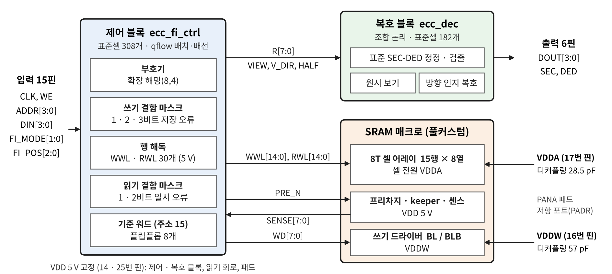
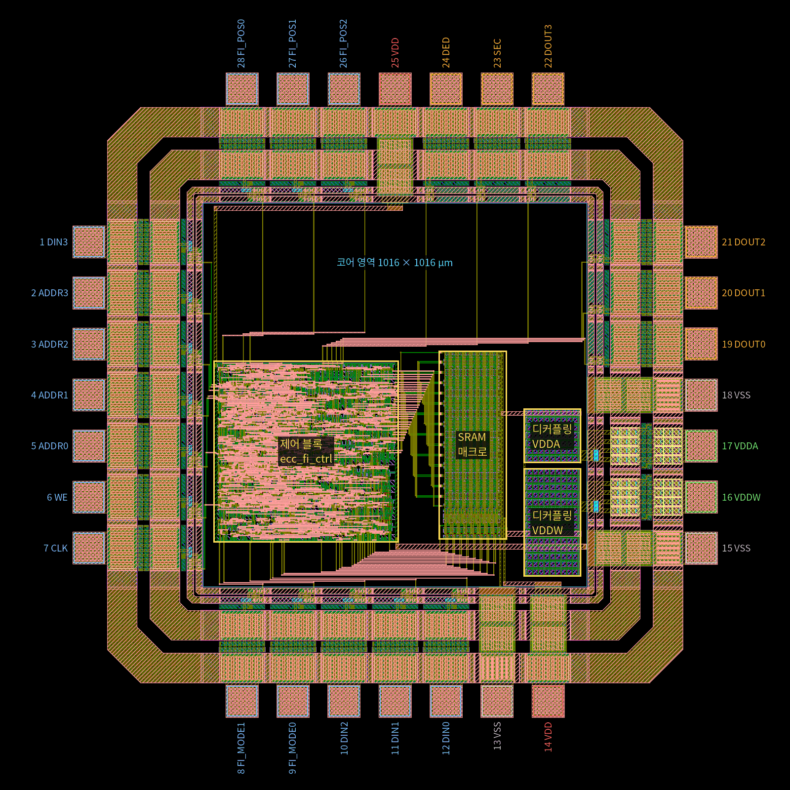
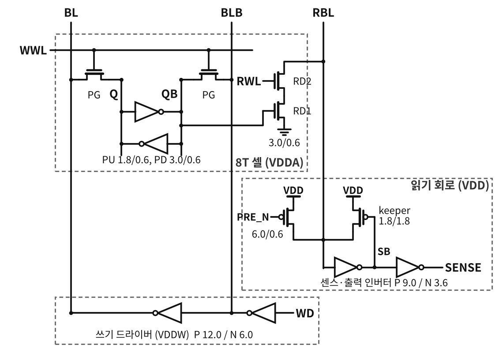

# 결함 주입 ECC 8T SRAM 칩 최종 보고서

2026-11-11

## 요약

2026년 4차 마이칩 제출용 칩 GDS가 완성됐고, 제출 전에 할 수 있는 검증을 모두 통과했다. 남은 일은 신청서 마무리와 서명, 12월 7일까지의 업로드다.

이 칩은 16워드 SRAM에 Hamming(8,4) SEC-DED를 붙이고 오류를 일부러 넣어, ECC가 무엇을 고치고 무엇을 놓치는지 재는 칩이다. 셀 전원 VDDA와 비트라인 드라이버 전원 VDDW를 따로 낮춰 실제 저전압 결함을 만든다. 저전압 실패의 방향(0 → 1)을 아는 복호로, 표준 SEC-DED가 틀린 값으로 고치는 한 방향 3비트 오류를 검출한다.

| 항목 | 결과 |
|---|---|
| 공정·크기 | ETRI NSPL 0.5 µm CMOS 2P3M 5 V, 1.9 × 1.9 mm 표준칩(MPW_PAD_28pin), 설계 면적 1016 × 1016 µm |
| 칩 전체 규칙 검사 | 공식 DRC 0, Calibre 전용 73규칙 0, 안테나 0, 코어 LVS 일치(3,982 소자 · 1,909 넷) |
| 논리 시험 | 칩 코어 논리 235,865회 비교 통과, 복호 블록 입력 2,048가지 전수 통과 |
| 트랜지스터 수준 모의 | 코어 전체 추출, 4개 조건(TT, SS 125 °C, FF 0 °C, VDDA·VDDW 2 V)에서 읽기 25번 모두 ECC 모델과 같음 |
| 재현성 | 저장소를 새로 받아 다시 만든 GDS와 최종 GDS가 19개 층 모두 XOR 0 |
| 제출 파일 | `ecc_sram_Top.zip` 1,029,331 B(안에 `ecc_sram_Top.gds`), sha256 `842d412f…7622d8` |

최종 파일은 [`designs/etri050/chip/final/`](../designs/etri050/chip/final)에 있고, 같은 파일을 [릴리스 v1.0](https://github.com/mseokq23/ecc_sram/releases/tag/v1.0)에서도 받을 수 있다. 사양은 [spec.md](spec.md), 단계별 검증 기록은 [verification.md](verification.md), 결과물 보는 법은 [guide.md](guide.md)에 있다.

## 칩의 목표와 주제

목표는 ECC가 실제 물리 결함을 고치고 검출하는지 칩에서 재는 것이다. 오류는 두 가지로 만든다.

1. **논리 결함 주입**: FI_MODE·FI_POS 핀으로 고른 비트를 쓸 때(1·2·3비트) 또는 읽을 때(1·2비트) 뒤집는다. 결과가 정해져 있어 ECC 회로 자체를 시험한다.
2. **물리 결함**: VDDA를 낮추면 보존 실패와 읽기 실패, VDDW를 낮추면 쓰기 실패가 실제 셀에서 생긴다. 어느 비트가 먼저 틀릴지는 셀마다 다르다(공정 편차).

원시 보기(읽기 모드 11)는 저장된 8비트를 정정 없이 읽는다. 원시 보기로 만든 실패 비트 지도와 같은 워드의 정정 출력·SEC/DED를 비교하는 것이 측정의 중심이다.

둘째 축은 물리 결함의 성질을 ECC 판정에 되돌려 쓰는 것이다. 저전압 읽기·쓰기 실패는 0이 1로만 바뀐다. 방향 보기(FI_POS 011)는 이 방향을 알고 같은 부호, 같은 저장 비트를 다시 판정한다. 확장 해밍 (8,4) 부호는 자기 쌍대라, 한 방향 3비트 오류는 표준 복호가 모두 틀린 값으로 고치고 방향 보기는 모두 검출한다.

| 틀린 비트 수(16개 부호어, 한 방향 오류 전부) | 패턴 | 표준 SEC-DED | 방향 보기 |
|---|---|---|---|
| 1 | 64 | 64 고침 | 64 고침 |
| 2 | 112 | 112 검출 | 28 고침, 84 검출 |
| 3 | 112 | 112 오정정(틀린 값 + SEC) | 112 검출 |
| 4 | 84 | 56 검출, 28 오정정 | 56 검출, 28 오정정 |

측정으로 확인할 것은 둘이다. 저전압에서 실제로 나오는 오류가 한 방향인지, 그리고 표준 복호의 무증상 오류가 방향 보기에서 얼마나 검출로 바뀌는지다.

## 칩 구성

칩은 ETRI GPIO 원본 셀로 만든 28핀 패드 링과 그 안의 1016 × 1016 µm 코어로 이뤄진다. 코어에는 블록 다섯 개가 있고, 트랜지스터 게이트는 패드 셀을 포함해 5,390개다.

제어 블록은 읽은 워드 R까지 만들고, 위 채널의 metal3 11넷을 거쳐 복호 블록이 판정해 출력 패드를 구동한다.

| 블록(셀 이름) | 하는 일 | 자리(µm) |
|---|---|---|
| 제어 블록 `ecc_fi_ctrl_F` (표준셀, qflow) | 부호기, 쓰기·읽기 결함 마스크, 행 해독, 기준 워드(주소 15, 플립플롭 8개) | (470, 560)–(953.6, 1077.15) |
| 복호 블록 `ecc_dec_F` (표준셀, qflow, 조합 논리) | 표준 복호, 원시 보기, 방향 복호, 출력 6개 구동 | (560, 1150.2)–(1016.6, 1376.1) |
| SRAM 매크로 `sram_macro` (맞춤 설계) | 8T 셀 15행 × 8열, 프리차지·keeper·센스·비트라인 드라이버 | (1065, 567.4)–(1246.5, 1066.3) |
| 디커플링 `decap_vddw`, `decap_vdda` | MOS 커패시터 VDDW 57 pF, VDDA 28.5 pF | (1290, 470)–(1442.4, 913.7) |
| 패드 링 `ecc_sram_Pad` | PIC 15, POB8 6, PVDD 2, PVSS 3, PANA 2(PADR 포트) | (97.5, 97.5)–(1802.5, 1802.5) |

8T 셀은 18.0 × 27.3 µm(PU 1.8/0.6, PD 3.0/0.6, PG 1.8/0.6, 읽기 RD1·RD2 3.0/0.6 µm)이다. 전원은 셋이다: VDD(제어·복호 블록, 읽기 회로), VDDA(셀), VDDW(쓸 때 비트라인 높은 값).

핀 번호는 패키지 핀 번호와 같다(반시계, 마이칩 공지 #768).

| 핀 | 신호 | 패드 셀 | 핀 | 신호 | 패드 셀 |
|---|---|---|---|---|---|
| 1 | DIN3 | PIC | 15 | VSS | PVSS |
| 2 | ADDR3 | PIC | 16 | VDDW | PANA (PADR) |
| 3 | ADDR2 | PIC | 17 | VDDA | PANA (PADR) |
| 4 | ADDR1 | PIC | 18 | VSS | PVSS |
| 5 | ADDR0 | PIC | 19 | DOUT0 | POB8 |
| 6 | WE | PIC | 20 | DOUT1 | POB8 |
| 7 | CLK | PIC | 21 | DOUT2 | POB8 |
| 8 | FI_MODE1 | PIC | 22 | DOUT3 | POB8 |
| 9 | FI_MODE0 | PIC | 23 | SEC | POB8 |
| 10 | DIN2 | PIC | 24 | DED | POB8 |
| 11 | DIN1 | PIC | 25 | VDD | PVDD |
| 12 | DIN0 | PIC | 26 | FI_POS2 | PIC |
| 13 | VSS | PVSS | 27 | FI_POS1 | PIC |
| 14 | VDD | PVDD | 28 | FI_POS0 | PIC |

## 동작

한 클록에 한 워드를 쓰거나 읽는다. CLK = 0이면 읽기 비트라인을 프리차지하고, 입력(ADDR, WE, DIN, FI_*)은 이때만 바꾼다. CLK = 1이면 고른 행을 쓰거나 읽고, 읽기 출력은 CLK = 1인 동안 유효하다.

코드워드는 C[7:0] = {D3, D2, D1, P2, D0, P1, P0, PALL}이고, 신드롬 값이 틀린 비트의 위치다.

| FI_MODE | 쓰기(WE = 1), k = FI_POS | 읽기(WE = 0) |
|---|---|---|
| 00 | 부호 그대로 저장 | 정상 읽기, DOUT = 정정한 데이터 |
| 01 | 비트 k를 뒤집어 저장(1비트 저장 오류) | 센스 뒤 비트 k 뒤집기(일시 오류) |
| 10 | 비트 k, k^1을 뒤집어 저장(2비트) | 센스 뒤 비트 k, k^1 뒤집기 |
| 11 | 비트 k, k^1, k^2를 뒤집어 저장(3비트) | 보기(아래), FI_POS[2:1]이 고름 |

읽기 모드 11의 보기는 셋이다.

- **원시 보기**(FI_POS 000·001·1xx): 저장된 8비트를 정정 없이 내보낸다. FI_POS0 = 1이면 데이터 4비트, 0이면 검사 4비트다. SEC·DED는 저장 워드의 표준 판정이다.
- **방향 보기, 0 → 1 가정**(FI_POS 011): 저전압 읽기·쓰기 실패를 가정해 다시 판정한다.
- **방향 보기, 1 → 0 가정**(FI_POS 010): 반대 방향을 가정한다.

방향 보기의 {SEC, DED}는 00 오류 없음, 10 한 비트 고침, 11 두 비트 고침, 01 검출이다. 방향 보기에서 DIN3 = 1이면 읽은 워드의 비트 DIN[2:0]을 한 번 더 뒤집는다(논리 시험용). 그래서 **방향 보기로 읽을 때는 DIN = 0**으로 둔다.

측정 클록은 수 kHz–1 MHz면 충분하다. 칩 코어 모의에서는 주기 200 ns에서 CLK = 1 구간이 끝나기 5 ns 전에 모든 출력이 맞았다.

## 설계 흐름과 도구

모든 단계를 오픈소스 도구로 했고, 소스에서 블록과 칩을 다시 만들어 모든 검사를 돌리는 `chip/check_all.sh`가 최종 GDS를 저장한다(2-core에서 약 7분). 환경은 ETRI 0.5 µm 오픈소스 디자인 킷(4b332a7, 2026-11-02)과 PDK 260820이다.

| 단계 | 방법 | 도구 |
|---|---|---|
| 8T 셀·어레이 | 파이썬 생성기로 레이아웃과 비교용 넷리스트를 함께 만듦(`gen/sram8t.py`) | Magic |
| 컬럼 회로·SRAM 매크로, 디커플링 | 같은 방식(`gen/colper.py`, `gen/decap.py`) | Magic |
| 제어·복호 블록 | Verilog RTL → 합성 → 배치·배선 → 금속 틈 메우기, 0.01 µm 격자 → 매크로 고정 | Yosys 0.33, qflow(GrayWolf, Qrouter), Icarus Verilog 12 |
| 패드 링 | 킷 28핀 템플릿 자리에 ETRI GPIO 원본 셀(250610)을 넣음(`chip/pad_gds.py`) | Magic, KLayout |
| 칩 조립 | 블록 배치, 위 채널 metal3 배선, 전원 띠(`chip/assemble.py`) | KLayout 파이썬 |
| 회로 모의 | PDK 260820 모델(`05cmos_mosfet_corner.lib`, TT·SS·FF·SF·FS) | ngspice-42 |
| 검사 | 공식 규칙 KLayout 덱, Calibre 전용 73규칙, 규칙 문서 금속·안테나 규칙, LVS, 제출 GDS 검사 | KLayout 0.28.16, Magic 8.3.105, Netgen 1.5.133 |

표준셀 합성에서는 셀 안 metal2 간격이 규칙(1.0 µm)보다 좁은 XOR2X1·XNOR2X1·FAX1·HAX1·LATCH·TBUF를 뺐다. 두 블록은 같은 설정으로 다시 돌리면 같은 도형이 나온다.

## 검증 결과

셀부터 칩 전체까지 모든 검사를 통과했고, 칩 전체 규칙 검사에서 남는 표시는 손대지 않은 ETRI GPIO 셀 안의 64개뿐이다.

| 대상 | 검사 | 결과 |
|---|---|---|
| 8T 셀 | 코너·온도·전압 45조건 쓰기·읽기, 보존 전압, 읽기·쓰기 Vmin | 모두 통과. 보존 전압 TT 0.37 V, 읽기 Vmin(VDDA) TT 1.42 V, 쓰기 Vmin(VDDW) 1.73–1.94 V |
| SRAM 매크로 | 레이아웃 추출(기생 C × 1.5), 5 코너와 VDDA·VDDW 2.0 V에서 쓰기·읽기 | 240비트씩 오류 0 |
| 제어·복호 블록 논리 | 칩 코어 논리 시험(RTL, 게이트, 배치 후, 고정 넷리스트) | 235,865회 비교 통과(방향 보기 30,206회, 프리차지 구간 14,094회) |
| 복호 블록 | 입력 11비트 2,048가지 전수 | 통과 |
| 두 블록 RTL | 일부러 틀리게 만든 RTL 14개 | 모두 걸림 |
| 블록 레이아웃 | Magic DRC, 공식 DRC, LVS, 추가 규칙 | 0, 0, 일치, 0 |
| 칩 전체 | 공식 DRC(킷이 ETRI Calibre 덱을 옮긴 KLayout 덱, 규칙 115개) | 0 |
| 칩 전체 | Calibre 덱에만 있는 73규칙 | 0 |
| 칩 전체 | 규칙 문서 값 7–12(금속·비아) | 64, 모두 ETRI GPIO 셀 안(패드 링만 검사해도 같은 자리), 코어 0 |
| 칩 전체 | 안테나 규칙(다이오드 몫 없이) | 0 |
| 코어 | 트랜지스터 수준 LVS(Magic 추출 + Netgen) | 일치, 3,982 소자 · 1,909 넷 |
| 코어 | 기판·우물 접점이 금속으로 전원 패드에 이어지는지 | 모두(p+ 4,019개, n+ 4,676개) |
| 칩 전체 | 접촉이나 패드에 이어지지 않은 금속 | 0(금속 넷 1,269개) |
| 최종 GDS | 제출 GDS 검사(층, 0.01 µm 격자, 레인, 패드 개구, GPIO 원본, 기판 접속), 검사기 자체 시험 | 통과(실패 0, 경고 0), 11가지 모두 기대대로 |

칩 코어 트랜지스터 모의는 코어 전체를 소자 4,236개와 기생 C 12,041개로 추출(C × 1.5)해 37주기의 쓰기·결함 주입·읽기를 ECC 모델과 비교했다. 입력은 패드의 코어 쪽에서 넣었다.

| 조건 | 읽기 25번(방향 보기 8번 포함) |
|---|---|
| TT 27 °C, 5 V | 모두 맞음 |
| SS 125 °C, 4.5 V | 모두 맞음 |
| FF 0 °C, 5.5 V | 모두 맞음 |
| TT 27 °C, VDD 5 V, VDDA = VDDW = 2.0 V | 모두 맞음 |

그린 그대로의 코어에서 데이터 0 워드의 2비트 저장 오류는 방향 보기가 고쳤고, 3비트 저장 오류는 정상 읽기가 틀린 값 + SEC, 방향 보기가 검출로 냈다. 전원 전류는 FF 0 °C 5.5 V, 주기 200 ns에서 VDD 평균 0.92 mA, VDDW 57 µA, VDDA 4.8 µA다.

- **재현성**: 저장소를 새로 받아 소스에서 다시 만든 칩은 모든 검사를 같은 수치로 통과했고, 최종 GDS와 19개 층 모두 XOR 0이다. 최종 코어에서 다시 추출한 넷리스트는 모의 넷리스트와 같다.
- **동작 보존**: 방향 보기를 빼면 제어 출력과 복호 출력이 이전 설계와 같다는 것을 형식 등가(yosys SAT)로 확인했다.
- **검증에서 잡은 것**: 조립 첫판에서 복호 블록 배선과 위 채널 배선이 닿아 R7·VIEW·V_DIR·HALF 네 넷이 합쳐졌다. 공식 DRC로는 안 보이고 코어 LVS가 잡았으며, 고친 뒤 일치한다.

## 제출 준비

모아팹에 올릴 설계 DB는 `ecc_sram_Top.zip` 하나다. 저장한 GDS를 풀어 제출 GDS 검사를 다시 통과시켜 만들었고, 모두 `designs/etri050/chip/final/`과 [릴리스 v1.0](https://github.com/mseokq23/ecc_sram/releases/tag/v1.0)에 있다.

| 파일 | 내용 |
|---|---|
| `ecc_sram_Top.zip` | 제출 파일. 안에 압축하지 않은 `ecc_sram_Top.gds` 하나. 1,029,331 B, sha256 `842d412f…7622d8` |
| `ecc_sram_Top.gds.gz`, `.sha256` | 최종 GDS(최상위 셀 `ecc_sram_Top`). 압축 전 4,744,300 B, sha256 `73fd2967…5cccb4` |
| `check_report.txt` | 이 GDS를 만든 전체 재검사 기록, 모두 통과 |
| `ecc_sram_Top_gds_check.txt` | zip을 만든 제출 GDS 검사 기록 |
| `DRC_ecc_sram_Top.png`, `LVS_ecc_sram_core.png` | 신청서용 DRC·LVS 결과 화면 |

형식은 킷에 있는 2026년 3차 칩 4개(bricks_out, dino_run, invaders, pong_vh)와 제작된 pong_pt1(2025)을 같은 검사기로 비교해 맞추었다. 칩 범위 97.5–1802.5 µm, 스크라이브 레인 비움, CHIPBOUNDARY·실링 없음, 본딩 패드가 MPW_PAD_28pin과 XOR 0, GPIO 원본 셀, 최상위 라벨 없음이 선례와 같다.

신청서에 쓰는 값:

| 항목 | 값 |
|---|---|
| 설계명 | 저전압 SRAM 오류 실측을 위한 결함 주입·방향 인지 ECC 8T SRAM |
| 설계 DB 파일명(Top Cell 명) | `ecc_sram_Top.zip`(Top Cell `ecc_sram_Top`) |
| 설계 사용 Tool | Magic, KLayout, Netgen, ngspice, Yosys, qflow(GrayWolf, Qrouter), Icarus Verilog(오픈소스) |
| 표준칩 배치(MPW_PAD_28pin) | 사용 |
| 제공한 PDK의 GPIO | 사용: PIC 15, POB8 6, PVDD 2, PVSS 3, PANA 2(PADR 포트) |
| 칩 제공 형태 | 28pin-SOP 패키지(only) |
| 설계 면적 | 1칩(패드 셀 안쪽 1016 × 1016 µm) |
| 사용 소자 | NMOS, PMOS(디커플링도 MOS 커패시터). 저항·다이오드는 ETRI GPIO 셀 안에만 있다 |
| Rule Check | DRC O, LVS O, PEX O(Magic 기생 C 추출, R 제외, 계수 × 1.5로 칩 코어 후모의) |
| DRC·LVS 결과 화면 | `DRC_ecc_sram_Top.png`, `LVS_ecc_sram_core.png` |

## ETRI 답과 결정 사항

이 칩으로 ETRI에 새로 물을 것은 없다. 11월 1일에 올린 문의 #1303(이전 설계 기준)에 11월 6일 관리자 답(#1311)이 달렸고, 이 칩에 해당하는 내용은 아래와 같다.

| 물은 것 | ETRI 답 | 이 칩에서 |
|---|---|---|
| 오픈소스 도구 결과로 접수, Calibre 회신 | 오픈소스 도구로 설계·신청 가능. 제작 결과는 설계자가 감수하고, ETRI는 DRC 검토를 따로 하지 않음 | 공식 덱 변환 DRC, Calibre 전용 규칙, LVS, 안테나를 모두 직접 통과 |
| PANA 무저항 포트 | 회로 설계 방법은 답하기 어렵고, ESD 검토가 필요 없다고 판단하면 써도 됨 | VDDA·VDDW 모두 저항 포트 PADR이라 해당 없음 |
| 패키지·칩 수량 | 패드 번호 = 리드 번호(공지 #768). 26-4차까지 패키지 20개 + bare die 30개, 둘은 같은 웨이퍼 | 핀 번호를 패드 위치로 다시 매겨 확인 |
| 전류 밀도 | 확인된 자료 없음, 지속 전류 구조는 보수적으로 | VDD 평균 0.92 mA 수준이라 해당 없음 |
| 공정 측정값 | 26년 1차 MPW의 트랜지스터 측정값을 받음 | 실제 공정은 TT와 SS 사이. 칩 모의의 SS 125 °C 4.5 V가 이 범위를 덮음 |
| 일정 | 마감 12월 7일, 미리 알리면 여유를 줄 수 있음 | 설계 완료 |
| 신청 자격 | 어떤 회로든 접수·심사 대상, 설계 의도와 검증 내용을 잘 반영할 것. 지도교수 승인이 필요 | 신청서에 지도교수 서명 |

답이 없는 셀 이름 접두어, 실링, 최상위 라벨은 같은 형식으로 제작된 pong_pt1(접두어 없는 셀, 실링·라벨 없음)을 근거로 정했다. CHIPBOUNDARY는 넣지 않아도 된다는 답이 있다(QnA #1226). 11월 2일 이후 새 질문(고전압·칩 면적, Triple-well)과 공지는 이 칩과 관련 없다.

## 측정 계획

칩을 받으면 아래 순서로 잰다. 측정 클록은 수 kHz–1 MHz로 하고, 입력 핀은 띄우지 않는다. 패키지가 Open Cavity 28핀 SOP라 측정 때 빛을 가린다.

1. **정상 동작**: VDD = VDDA = VDDW = 5 V. 16워드에 서로 다른 값을 쓰고 읽기, 체커보드와 반전.
2. **논리 결함 주입**: 쓰기 모드 01·10·11, 읽기 모드 01·10. 1비트는 정정되고 SEC, 2비트는 DED, 3비트는 오정정(SEC)으로 나와야 한다.
3. **물리 결함**: 원시 보기로 실패 비트 지도를 만들고 정정 출력·SEC/DED와 비교한다.
   - 보존: 5 V에서 쓰고 VDDA·VDDW를 V_hold로 10 s 이상 둔 뒤 5 V에서 읽기. 0.60 V부터 10 mV씩, 값과 반전 두 패턴(모의 보존 전압 TT 0.37 V).
   - 읽기 Vmin: VDDA(= VDDW)를 낮춘 채 읽기. 0으로 저장된 비트가 1로 읽힌다(모의 TT 1.42 V).
   - 쓰기 Vmin: VDDA = 5 V, VDDW를 낮춰 쓰고 5 V에서 읽기(모의 1.73–1.94 V).
4. **방향 복호**(읽기·쓰기 Vmin과 함께): 실패 비트가 모두 0 → 1인지 먼저 확인한다. 같은 워드를 정상 읽기, 방향 보기(FI_POS 011, DIN = 0), 원시 보기 두 번으로 잇달아 읽어 맞음·검출·무증상 오류로 나눈다. VDDA를 1–2 mV씩 낮추며 두 패턴을 본다.
5. **어레이가 동작하지 않을 때**: 주소 15(표준셀 기준 워드)로 2와 4의 논리 시험을 시연한다.

전원은 VDD를 먼저 켜고 VDDA·VDDW를 나중에 켠다. VDDA·VDDW는 VDD보다 높이지 않는다(PANA의 ESD 다이오드가 켜진다).

## 남은 일과 위험

설계는 끝났고 남은 일은 서류다. 마감은 신청서와 설계 DB 모두 2026년 12월 7일이다.

- [ ] 신청서 마무리: 학생 정보, 연계 교육 프로그램, 지도교수 정보
- [ ] 대표 학생·지도교수 서명
- [ ] 모아팹에 신청서와 `ecc_sram_Top.zip` 업로드, 접수 확인 메일 확인
- [ ] 선정 확인(마이칩 공지) 2026년 12월 21일
- [ ] 측정 보드(SOP-28 소켓, 5 V 입력)와 절차 준비, 칩 수령(DB 마감 약 5개월 뒤) 전

| 위험 | 대책 |
|---|---|
| 설계 셀 6개(sram_macro 등)에 설계 이름 접두어가 없음 | 제작된 선례도 같은 형식. 필요하면 조립에서 이름만 바꿔 다시 만듦(도형 그대로) |
| ETRI 공식 Calibre로는 돌리지 않음 | 공식 규칙을 옮긴 덱, Calibre 전용 73규칙, 규칙 문서 값까지 코어 0. ETRI는 오픈소스 결과로 접수 |
| 기생 C 계수가 ETRI 값이 아니라 킷의 Magic 값 | C를 1.5배 키워 모의 |
| 실제 공정이 느린 쪽(26년 1차 측정) | SS 125 °C 4.5 V 모의 통과 |
| 저전압 오류가 한 방향이 아닐 때 | 방향 보기는 정상 읽기를 대신하지 않는 추가 보기. 원시 보기로 방향을 먼저 확인 |
| Open Cavity 패키지로 빛이 들어감 | 측정 때 빛 차단(누설이 늘면 보존 결과가 달라짐) |
| SRAM 어레이 불량 | 주소 15(표준셀)로 ECC·결함 주입 시연 |
